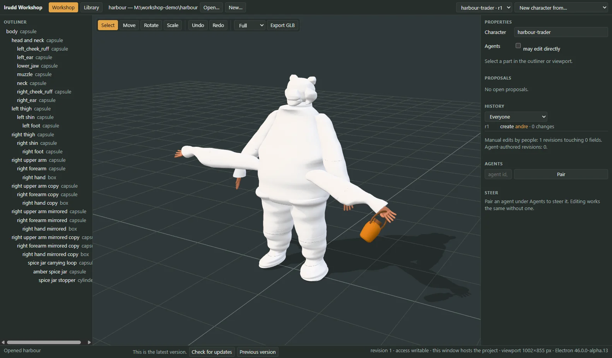

# Irudd Workshop

Irudd Workshop is a desktop app for shaping 3D game characters and exporting rigged, animated GLBs. You can edit a character by hand, pair an agent to propose changes in the same project, and open the result in the built-in player.

## Windows

On Windows 11 x64 with [Git for Windows](https://git-scm.com/download/win), run this in PowerShell.

```powershell
irm https://raw.githubusercontent.com/alundgren/irudd-game-tools/main/install.ps1 | iex
```

Open **Irudd Workshop** from the Start menu.

## Mac

With the Xcode Command Line Tools installed, run this in Terminal.

```sh
curl -fsSL https://raw.githubusercontent.com/alundgren/irudd-game-tools/main/install.sh | bash
```

Open **Irudd Workshop** in your home Applications folder. [Updates and installation paths](docs/desktop-install.md)

## Make a character



On first launch, click **New random human** or pick a starter from **New character from…**. Your untitled project stays in memory. Choose **Save character…** when you want to keep a character with its artwork and history. For a project that saves each edit automatically, choose **New folder project…**.

Select a part in the outliner and drag it with **Move**. Each completed edit appears in History. Choose **Export GLB** to open that revision in the Library, where you can play its animations and save an inspection sheet.

To try a repaint, start **feline-worker**, pair an agent, and select the painted body. In **Artwork**, send a turnaround brief to the paired conversation. Preview the returned sheet and accept it if you want to keep it. You can undo the repaint from the editor. [Pair an agent and request artwork](docs/workshop-clients.md)

The app code is MIT-licensed. Character assets carry their own credits. [License](LICENSE) · [Artwork and references](docs/artwork.md)
