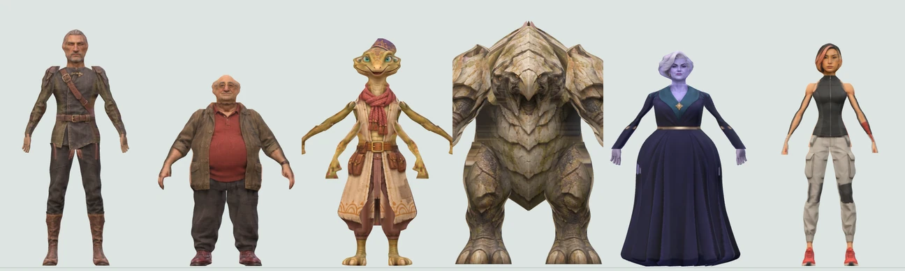

# irudd-game-tools

MIT-licensed tools for making games. The first tool is a 3D character workshop built with Three.js. Start with one form and keep changing it. A human, a four-armed trader and a low gliding animal use the same editable parts.

[Browse the six benchmark creations and their authors](docs/creator-benchmarks.md) · [3D results and comparisons](docs/workshop-results.html) · [Experiment plan, including the later 2D character sheet](docs/character-creator.html)

## Run it

With Node.js 22 or later, run `npm ci` and `npm start`. Open the localhost URL in the terminal. **Generate variation** asks for a geometry edit. **Generate painted variation** creates new four-view artwork and fits it as editable 3D. Both use the installed, signed-in Codex CLI. Painted generation also requires its image generation tool. The browser submits the current geometry, two rendered views, any pending nudges, a random design direction and your instructions. Inspect the result from several angles before accepting it.

For offline use, run `npm run build` and open `dist/character-view.html` in a WebGL 2 browser. **Export AI request** and **Load proposal** let an external agent perform the same exchange through JSON. Use **Refine this proposal** to give the agent another direction before accepting. It receives the visible candidate, two new renders and the metric bounds of its regions. **Previous proposal** restores an earlier round. The original stays available for comparison and one acceptance creates one undo step. The offline editor can export and load a refinement using the same JSON protocol. The separate `dist/play-model.html` player opens exported GLBs and measures their animation in a clean Three.js scene.

Fourteen example GLBs are included. The [harbour spice merchant](examples/harbour-trader.glb) has four articulated hands and a palm-carried jar. The [concert skirt](examples/relay-concert.glb) carries folded fabric through a stride and crouch. The [landmark-fitted dockworker](examples/landmark-surveyor.glb) and [ranger](examples/landmark-ranger.glb) carry frontal geometry edits. The [profile-fitted ranger](examples/traced-ranger.glb) carries a brow-to-chin contour traced from a historical photograph. Try the [fitted aquatic merchant](examples/quayside-fitted.glb) in the player to see the fin roots follow the swimming tail. Click a surface for the exported region name and world position in metres. The [aquatic cargo merchant](examples/quayside-merchant.glb) records two live, steered revisions of the four-handed body. The [four-handed merchant](examples/merchant-gesture.glb) carries a greeting pose alongside its four movement clips. The [portrait with movable eyes](examples/portrait-gaze.glb) supports four gaze directions and a blink. Choose **Face close-up** in the player and use the two look controls. The [fen-crowned eel](examples/fen-crown.glb) carries a freeform bony sail with a true opening. A [tidal surveyor](examples/tide-surveyor.glb) keeps the researcher’s face and vest through a change from legs to an animated serpent body. The [glassgrass eel](examples/glassgrass-eel.glb) has an articulated axial spine with swimming, slithering and coiling clips. Open the player and choose the [wet-weather biologist GLB](examples/field-wardrobe.glb) or the [reef cartographer GLB](examples/reef-cartographer.glb). The [biologist's editable wardrobe](examples/field-wardrobe.form.json) contains all three saved outfits.

To steer a face with a front photograph, choose **Match facial landmarks**. Place the same two alignment points on the rendered head and photograph, then pair the features to move. Work from a close front view and use further passes for local revisions. The [two-face comparison](docs/workshop-results.html#paired-faces) measures the exported result.

For a reference-guided face, select a head and open **Shape from a side portrait**. Load a cropped profile and trace its forward edge from brow to chin. Adjust the fit strength on the current character. **Face in profile** and **Face at three-quarter** in the GLB player show the exported geometry at eye level. The [profile experiment](docs/workshop-results.html#traced-profile) includes the source and the measured change.

To fit an attachment, select its region in **Build parts**, choose a cage face or an end of a swept part, set the depth in millimetres and choose **Seat on parent**. Select the full length when fitting piping along a surface. **Release fitting** restores the underlying editable shape. The [tail comparison](docs/workshop-results.html#surface-attachments) includes the editable form and measurements. With NumPy and SciPy installed, run `python scripts/measure-garments.py examples/quayside-fitted.glb --contact "swept rear dorsal fin" "estuary swimming tail" --samples 12` to check that joint at rest and during animation.

## Make a character

1. Choose **Forms → New form** or inspect a reference study. Choose a body plan, then regenerate from a new random seed. Graft components between forms, including your own saved JSON donors.
2. Use **Sculpt** for relative nudges. Choose a parted sweep, coils, braids or locs in **Style hair**. A change applies to the current shape, then the slider returns to neutral. Select a head for facial controls and **Style hair** for strand length, sweep, curls and a gathered tail, use **Edit on model** for direct manipulation, or **Pull surface** to drag any point with a soft radius. Mirror is optional. **Draw appendage** grows a tapered horn, fin, tail or walking limb from the surface in the direction you drag. Use **Join organic surfaces** to blend connected body volumes and keep their joints. Use **Surface markings** for bands, spots, rosettes and countershading. Select a sweep and choose **Spine → Edit on model** to drag a station and carry attached limbs and plates with it. Orbit to drag in a different plane. On a sweep, **Cloth** nudges the hem opening, slit height and folds.
3. Use **AI direction** for structural changes. Attach up to two **Visual references** and assign each one to the face, silhouette, garment or surface. Type what matters, keep selected shapes and pin either cue, and redraw the other. In **Your random choices**, enter a line such as `Locomotion = wade | glide | burrow`. The software draws among your options before calling the agent. **Keep alternate & return** saves the candidate and brings back the parent for another draw. Compare or accept any of these later under **Forms → Saved variations**. **Replay a direction** restores the cues, choice groups, pins and magnitude. Save the accepted form to reproduce its exact geometry. The agent can add limbs, change the spine, graft painted components or reshape existing regions. For a protected body, select a region and choose **Fit a garment to this part** to generate a wearable for its current outfit.
4. Switch between a practical base layer, work clothes and a pressure suit. **Repaint existing geometry** uses the original artwork to change the colors and print on a selected piece or its attached garment panels. Under **Cut clothing and save outfits**, cut a cape, poncho or tabard to the selected region. Adjust the opening, hem and folds, order and dye fitted layers, and save named outfits on the same body. Test the silhouette, check stature with **World scale**, and preview Idle, Walk, Crouch and Reach. Use **Pose joints** to start from rest, a saved pose or the current frame of a movement clip. Pick a joint and rotate or move it in the viewport, or nudge it along a local axis. Saving a pose adds a named clip to the GLB and keeps the rest shape editable. Human portrait heads can blink, smile and raise their brows in both the editor and the exported GLB. Select a head and use **Fit movable eyes** to register its eye openings and add separate horizontal and vertical gaze. The [eye-motion comparison](docs/workshop-results.html#eye-motion) shows the reduced exports. On a traced head, mark both pupils, nose, lips and chin to register a new face. On an isolated painted head, **Fit facial relief from the source views** generates a depth image and uses it to reshape the mesh. Choose **Match front and profile** in the trace editor to place a depth point by hand. A fitted source hairstyle can be removed, and **Fit a clean scalp under this hair** gives it a separate head underneath. On a painted hand, **Fit fingers to this hand** builds a jointed thumb and fingers.
5. Save editable JSON or export a GLB with materials, skin and embedded animations. Choose **Game** for a shared texture atlas and a mesh target of 24,000 triangles. Browser storage retains a working copy. Saving a form explicitly gives you a portable revision with its imported artwork.

**Forms → Trace a volume** accepts a square two-by-two turnaround on magenta or transparency. Place front and profile-left views on the top row, back and profile-right on the bottom row. Enter the standing height in metres. For a hooked tail, mark matching root-to-tip points using **Curved centreline**. For a thin fin, use the membrane option matching its direction in the two views. Draw corresponding regions in front and profile, or try **Fit whole biped** with a separated, upright A-pose.

## How the comparisons work

Six praised community creations from Dragon’s Dogma 2, Spore and The Sims 4 supplied design goals. Each has a procedural and a painted study. The two live AI anatomy trials are also editable in the workshop. Two held-out painted trials can be opened with **Forms → Open form**: a [four-legged lantern grazer](examples/lantern-grazer.form.json) and a [feline harbour worker](examples/feline-worker.form.json). An [aquatic reef cartographer](examples/reef-cartographer.form.json) shows editable fin membranes and a tail built from paired landmarks. A third outfit trial contains an independently fitted [rescue vest](examples/rescue-vest.form.json). An [original coastal biologist](examples/coastal-biologist.form.json) adds a newly generated, expression-capable face to the same rescue vest. An artist-written leg-count draw produced a [tripod](examples/marsh-tripod.form.json) and an [eight-legged animal](examples/marsh-eight-legs.form.json) around an identical locked body. The [benchmark gallery](docs/workshop-results.html) distinguishes authored studies, live proposals, shape recognition and game playback.

An [eleven-point eel](examples/glassgrass-eel.form.json) came from a live human-to-creature revision. A [printed rescue vest](examples/tidal-print.form.json) retains the source garment's exact geometry. The [historical portrait revision](examples/composed-portrait.form.json) includes six paired facial depth points.

**Cut clothing and save outfits → Skirt → Adjust the cut → Trace waist to hem** fits a photographed outline to the current wearer. Mark the waistband centre and one edge, then follow that edge downwards. Set diagonal gathers, tiers and train length, and save the outfit. The [relay wardrobe](examples/relay-wardrobe.form.json) opens with four saved looks on the same body. [Compare the reference proportions and movement](docs/workshop-results.html#traced-wardrobe).

A [pressure-suit poncho](examples/pressure-poncho.form.json) and a [four-armed trader’s cape](examples/four-arm-cape.form.json) exercise the wardrobe on different bodies. **Cut clothing and save outfits → Adjust the cut** lets you choose covered arms, open sides or armholes. The animated cape follows the arms at its sides and stays attached at the neck. [Garment motion measurements](docs/workshop-results.html#garment-motion)

**Place a branch on a surface** copies or moves the selected region and its children. Click its attachment point, then a point on the receiving part. Drag to orbit between clicks. For AI direction, open **Mark a location on the model**, name the point, and pick the socket on the character. Mention that name in your direction or refinement. The [editable spice merchant](examples/harbour-trader.form.json) and [placement comparison](docs/workshop-results.html#marked-branches) show a text-guided placement, its correction using two marked ribs, and the final moving connections.

**Compare sizes** puts the current form beside a pinned revision or another saved form. Read overall height and top-of-head height on a shared floor. Enter either measurement in metres to resize the current form uniformly before export.

Under **Sculpt → Build parts**, add a **Freeform control cage**. Select a face to extrude or inset it, or choose an opposite face and open a tunnel. Select a corner to drag it on the model. The [editable fen-crowned eel](examples/fen-crown.form.json) uses the same cage format in an agent-built crest.

Run `npm test` for local checks. To regenerate the benchmark screenshots, build the pages and run `python scripts/capture-studies.py` with Chrome, Playwright, Pillow and NumPy installed. The capture script drives the editor’s public controls.

## Artwork and license

The workshop meshes, surface patterns, garments and generated four-view art were made for this project. The historical likeness study uses an 1870 Frederick Douglass photograph by George Francis Schreiber. Its catalog record credits the Library of Congress and reports no known restrictions on publication. [Historical photograph and rights information](https://www.loc.gov/item/2004671911/). The raster artwork was created with OpenAI’s image generation tool. It is distributed here under the [MIT license](LICENSE). Community artwork remains at the linked sources. Three.js provides rendering and glTF import/export under MIT. The standalone builds embed license notices for Three.js and meshoptimizer.
