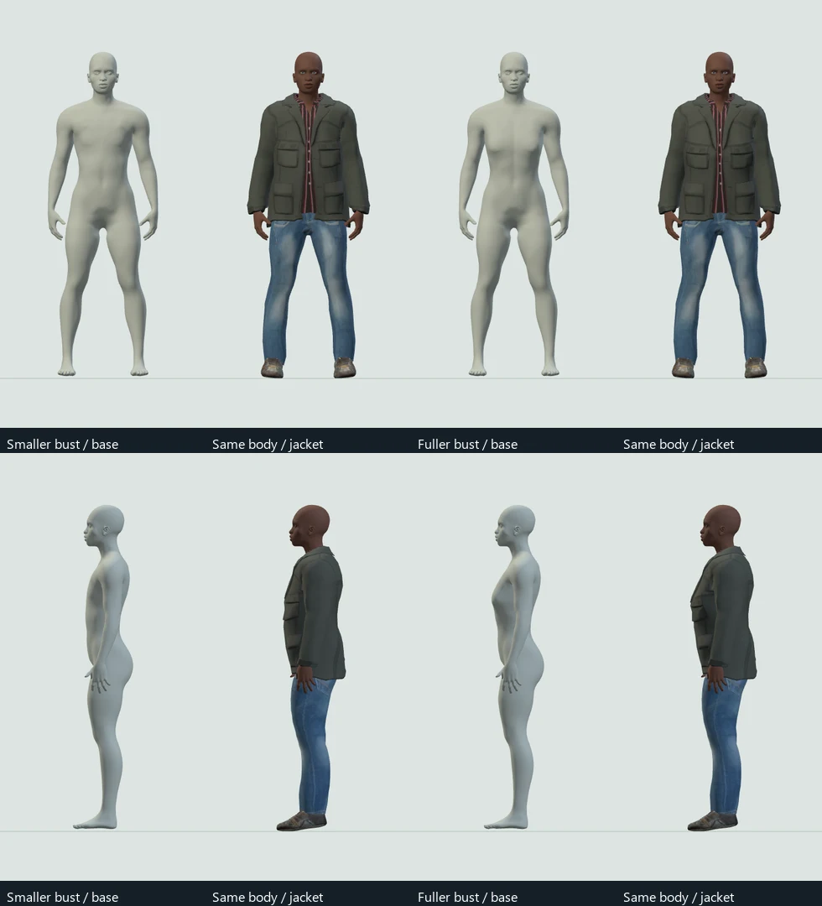
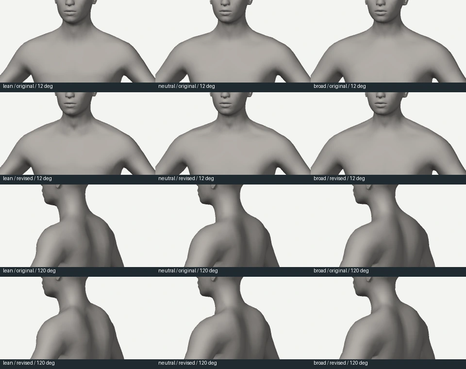
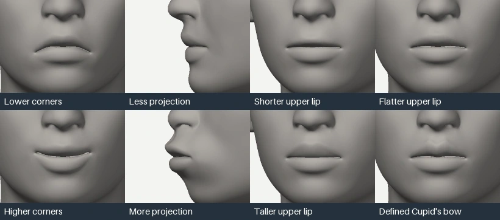
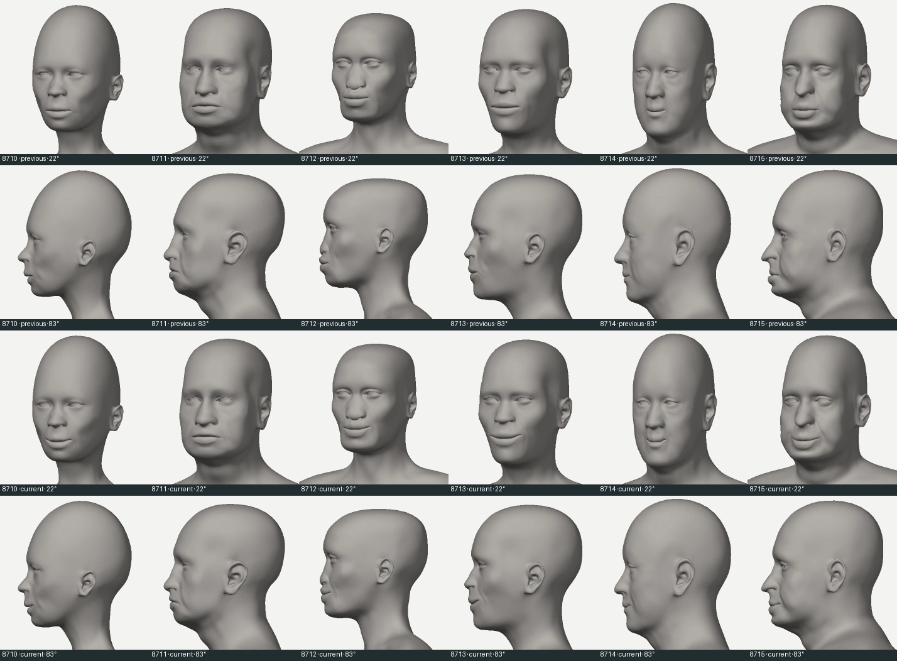

# Adult avatars

Open **Forms → Generate a starting form → Adult human** for a new seeded person. The female, male and neutral options set the initial frame. Every frame has the same measurements and wardrobe. Under **Sculpt → Adult anatomy**, choose **Body → Bust** and apply a positive or negative nudge to the current body. The separate rib cage, shoulders, waist, hips, and seat controls stay available. Open **Appearance** to try the same shirt, a dress or a bulky suit over the new proportions.

Under **Posture and walk**, choose **Right or left hand on hip** to rest a hand on the dressed waist. The middle of the slider lowers both hands. Either end places one palm against the clothing or belt at that hip. The gesture follows the standing and idle poses and releases during Walk, Reach and Crouch.

The base represents an unclothed adult with the broad contours that carry weight and give clothes their shape. In clay, you can inspect the rib cage, the transition into the chest, the underside of the bust and the abdomen. The chest surface and groin are smooth, and complexion detail is confined to the face. Stature is measured floor to skull in metres. Hair and heels can add to the visible height.



The front and side views show the compact, strong adult in each state at the same camera scale, with bust set to −0.8 or +0.8. In a separate 1.70 m test, the front chest contour moved 3.1 cm and the jacket moved 2.5 cm at chest height. The jacket waist and lower leg moved less than 0.1 mm. The garment's front panel takes support from the surrounding rib cage and drapes below the bust. This test covers the field jacket in the standing pose.

An assistant can reroll just the named measurements using the editor's variation seed. In a live proposal trial, asking for a halfway reroll of the nose and a modest shoulder nudge produced two operations. The editor drew nose width and bridge, then added 0.08 to shoulders. All other measurements and the traveller's outfit stayed identical. Replaying the same operations and direction seed reproduces the draw.

## Comparison with six 3D bodies

Six independent MHR targets were each fitted from the same 1.72 m neutral recipe. Each run loaded the reference in the live workshop and ran **Fit shape** once.

The targets, the fitted studies and the comparison sheet are [local reference material](local-references.md). In a copy that has them, each result is selectable under **Forms → Reference studies → 3D reference fits**. The sheet `docs/media/workshop-body-fits.webp` pairs each target on the left with its editable fit on the right, from front and oblique orthographic cameras.

| Target | Original mean | Fitted mean | Fitted 95th percentile |
| --- | ---: | ---: | ---: |
| F1 | 18.4 mm | 3.7 mm | 11.8 mm |
| F2 | 24.1 mm | 4.4 mm | 13.5 mm |
| F3 | 62.5 mm | 5.2 mm | 17.7 mm |
| M1 | 29.2 mm | 4.5 mm | 14.7 mm |
| M2 | 17.5 mm | 4.0 mm | 11.6 mm |
| M3 | 56.8 mm | 4.5 mm | 15.2 mm |

In the earlier arm-fitting experiment, the solver began using hand outlines as well as local surface normals when the arms are clearly separated from the body. On F3, mean arm error fell from 11.9 mm to 5.5 mm. On M3 it fell from 12.0 mm to 5.1 mm. F2's whole-body mean rose from 4.1 to 4.2 mm. [Run the six fits in the browser](../scripts/check-workshop-fits.py)

The camera-depth fitting pass constrains changes to the head using front and side surface samples. All six runs recorded zero head triangles turning through 90 degrees. On the fitted head crops, mean camera-depth error over common foreground pixels ranged from 2.2 to 3.3 mm at three-quarter view and 3.2 to 4.5 mm in profile.

These are editor-to-reference surface distances. The solver had access to the target. A small mean still allows conspicuous errors around the fingers, shoulder line or face. The separate benchmark tests two-way error and matching against the wrong person. [Per-region readings](media/workshop-body-readings.json) · [Independent benchmark](human-benchmark.md)

Across 64 consecutive unpicked adults (seeds 8710 through 8773), bare stature ranged from 1.52 to 1.98 m. At matched stature, the median pair differed by 35.7 mm at body landmarks and 10.2 mm at head landmarks (root mean square). The closest two heads differed by 3.4 mm. The comparison uses identical landmarks across characters, with heads centred at the skull joint. [Measurements and closest pairs](media/adult-diversity.json) · [Repeat the comparison](../scripts/adult-diversity.mjs)

### Fitting an isolated scan

In **Sculpt → Fit a 3D reference**, choose **Isolated head or bust** and open a local GLB. Choose **Match three landmarks**. For each landmark click its position on the reference and then the corresponding position on the editable head. Use the two outer eye corners and the front of the chin. The two panes share one orthographic camera. Orbit to check the position in depth, then choose **Fit shape**. Applying commits a single undoable change to the open person.

In a live run on the Lee Perry-Smith scan, the untouched editable head started 3.1 mm from the registered reference on average. The applied fit measured 2.0 mm, with the 95th percentile at 5.5 mm. The reference had closed eyes and an upper torso. The template had open eyes and a complete body. Only native head skin contributed to the 3D distance. **Measure this camera view** separately measures silhouette overlap and visible depth across the whole crop. A box moved 10 mm toward the camera measured 9.99994 mm on the hardware renderer, with 100% overlap. [Registration method](../character-view/head-registration.js) · [Independent head scans](head-scan-study.md)

### Fitting a partial surface

When a scan contains predominantly forward-facing triangles, the surface fitter limits corrections to the corresponding side of the editable body. In this case the dialogue labels its local error as applying to the observed side. A broad prior for height and build can still change both sides.

For each of the six practice bodies we reused the same saved measurements and alignment and supplied only its front-facing exterior triangles. We then sampled 10,000 points across the complete target, splitting their distances to the editable mesh by target normal. The earlier surface correction improved the visible front while pulling the unseen back of the legs inward. The revised correction leaves the back close to the initial body. Values are mean distances across subjects in millimetres.

| Target surface | Fitted measurements alone | Earlier surface correction | Revised surface correction |
| --- | ---: | ---: | ---: |
| Front, available for fitting | 5.69 | 2.40 | 3.25 |
| Back, withheld from fitting | 8.80 | 10.80 | 8.69 |

This is a development replay on the six known subjects. A partial scan with inconsistent triangle winding, or one that wraps well around both sides, can be harder to recognise automatically.

## Neck and shoulders

The hollow at the base of the neck and the collarbone are visible on the lean adult. Both soften on the fuller adult. The crest behind the neck also spreads into the shoulder. The change is subtle in the rear view. These are the same three generated bodies before and after shaping, with the same camera and clay material.



Across the six practice bodies, the shoulder silhouette 11 cm from the midline sat 7.7 mm below the reference on average before shaping and 3.8 mm after. Neck-base half-width error fell from 15.0 to 8.7 mm. Whole-body mean distance after fitting was 4.57 mm in both runs. These readings describe a local change to the collar and shoulder.

## Mouth shape

Under **Sculpt → Adult anatomy → Face**, mouth width and lip fullness can be nudged independently of corner height, forward projection, upper-lip height and Cupid’s bow. These edits change the resting mesh and carry through to the GLB. This is one neutral adult in clay with the same camera within each column. Across the full control ranges the greatest movement at a lip vertex was 8.0 mm at the corners, 14.2 mm for projection, 4.5 mm for upper-lip height and 2.5 mm for Cupid’s bow.



**Upper versus lower lip fullness** changes the balance between the lips. **Left resting smile** and **Right resting smile** move each corner and its neighbouring cheek. The central lip seam stays in place. **Smile opening** sets how much tooth the animated smile shows. **Smile bias** changes which corner lifts more during that smile. The resting expression stays editable independently.

The first two rows below show six consecutive adults before the change. The next two show the same seeds with the revised mouth controls. On seeds 8711 and 8712 the most prominent central lip point projected 3.1 and 6.7 mm past the line from the nose tip to the front of the chin. After adjusting the generated jaw and mouth together those readings became 1.5 and 2.9 mm. Across 64 consecutive draws the 95th percentile went from 5.0 to 2.2 mm. Distances use a common stature of 1.72 m. The line is an art-direction check for these generated starting faces. Artists retain the full range of jaw, nose and lip edits.



## The face of a new adult

A new adult's face is drawn as one person. The draw picks the ancestry of the skull, an outline for the face, and one type each for the nose, eyes, mouth and brow. Each choice moves the neighbouring controls together. Age folds the skin from nose to mouth and fills the lower lids, body mass fills the face, and a broad frame carries more brow and jaw. One side of the face differs slightly from the other. The mouth, lids and brow rest in one of seven moods, from a set mouth to a warm smile. Skin tone follows the same ancestry loosely, and the three ranges overlap. The draw of a seed's body is the one it always was.

Thirty-five face controls carry this. They cover the outline (long to round, oval to square, wide jaw to wide brow, diamond), face fullness, jaw corners, chin taper and cleft, the nose-to-mouth fold, cheek hollow, lower lid bag, seven nose controls, six eye controls, brow slant and ridge, forehead slope, lip height and six one-sided leans. All are under **Sculpt → Adult anatomy → Face** with a range of −1 to 1 and a start of 0. An adult saved before these controls existed has none of them and keeps its exact surface: 48 recipes drawn by the earlier generator gave identical vertices, joints and Smile targets before and after the change. Reference fits and proportion solvers leave these controls where they are.

Measured on 64 consecutive adults, comparing the front of the face with its position and size removed, the median difference between two faces is 5.5 to 5.6 mm, against 5.1 to 5.5 mm for the earlier draw on the same seeds (first seeds 8710, 52000 and 91500). The mean resting smile fell from 0.26–0.31 to 0.16–0.21 of the control's range, because the earlier draw lifted every mouth corner. The geometric spread is therefore about 5% larger. The size of the variation changed little. What changed is that it is organised into outlines, feature types, age and mood. [Face draw](../character-view/human-identity.js) · [Tests](../character-view/human-identity.test.js) · [Control packer](../scripts/pack-human-identity.py)

## Facial hair and the inside of the mouth

**Facial hair** in the adult styling list offers stubble, a moustache, a short beard and a full beard on any adult, in the chosen hair colour. Stubble is paint in the face texture. The other styles add a mass that stands off the skin by a few millimetres, cut along the line where the hair thins out and closed where it is deep, with loose strands over it. Every vertex of the mass and each strand copies the expression offsets of the skin under it, so the hair follows the jaw and a smile. The growth zones for the upper lip, chin and jaw are measured on the base head and packed as small grids, so the same zones drive the paint and the geometry. A complete look rolled from a seed gives facial hair to about half of the broad frames and to none of the slight ones; the list itself is open to every frame. The hair stops at the jaw line, where the face texture ends.

The shaped face has a deeper nostril opening, a recessed upper lip border, and a lip seam that projects between the two lips. Smile raises the lower lip, cheek and lower lid together. The skin mesh exports expression normals for Smile, Blink and BrowLift, and the Game mesh preserves the upper and lower lid margins.

The lining of the mouth in the source mesh is a cavity about 95 mm deep. The editor reshapes it into a pocket that ends about 13 mm behind the lips and moves with them, paints it dark, and stands two short generated rows of teeth inside it. The teeth are a separate mesh and are not part of the skin surface. Closed lips cover both rows. An expression that parts the lips slides the rows a few millimetres into the opening, the upper row showing most, so the same teeth serve a closed mouth and an open smile; this is a staging aid, not jaw anatomy. Brows, lashes, beard strands and teeth keep every triangle in a game export, which takes about 3,000 to 5,000 of its 24,000 triangles.

## Eyes

Each eye is generated for the head it sits in. A sphere is fitted to the socket of the base mesh and gives the centre the eye turns about and its radius, 14 to 17 mm on the six consecutive adults 8734 to 8739 at a common stature of 1.72 m. The lid opening is then read from the finished head skin, by testing where lid skin lies in front of that sphere, so sculpted and generated lids are followed. On the same six the openings measure 20.1 to 26.0 mm wide and 6.7 to 8.2 mm tall.

The iris is sized from the opening, half its width and held between 10.8 and 12.4 mm, and seated so that the upper lid covers its top edge and stays clear of the pupil. The iris fibres and crypts come from three CC0 MakeHuman eye textures. The packer removes the source brightness and hue so the selected iris colour and the scene lights apply to every eye. Each seed selects and rotates a stroma pattern. Both eyes share one height and one turn, so they look at the same point. A cornea rises 1.4 to 1.6 mm over the iris with the radius ratio of a real eye, 7.8 mm for an 11.7 mm iris.

The Game mesh preserves the lid edge and the adjacent ring of skin. These vertices hold the opening through a blink and retain the fold along the resting lid.

The eye has two parts in one mesh of about 950 triangles. A strip of white stays fixed in the socket and carries the shading that belongs to the socket: darker under the upper lid and lashes, a narrow contact line on the lower lid, corners that close in and turn pink, and the fleshy corner at the nose. The white takes a little of the skin's colour and yellows slightly with age. A front cap carries the cornea, iris, a soft limbus and a narrow margin of white, and it alone turns with the four gaze targets **LookLeft**, **LookRight**, **LookUp** and **LookDown**, about the fitted centre. The targets also turn the cap's normals.

No light is painted into the eye. The cornea is smoother than the white in the roughness map, so the highlight in the eye is the reflection of the scene's own lights and moves with them. It needs a light with a direction; a scene lit only by ambient light shows none, and a light high above the head puts it near the upper lid, where the lid can hide part of it. Shading, colours and gaze are ordinary vertex colours, textures and morph targets, so a single-material game export shows the same eye without a custom shader.

Limits: the cornea is an opaque painted surface with no refraction. The shading on the cap is exact for the resting gaze and approximate away from it. The lid edge is the polygon edge of the head mesh. The clay view cuts the iris and pupil into the surface instead. [Eye generator](../character-view/human-eyes.js) · [Tests](../character-view/human-eyes.test.js)

## Eyewear

Choose round wire, square acetate or upswept frames under **Sculpt → Appearance → Eyewear**. Each rim is centred on the corresponding eye. Bridge height and temple width come from the current head surface, including local sculpt edits. The frames have clear openings, so the eyes remain visible through the single-material game export. Changing the outfit or editing the head keeps the frame choice. A complete look rerolls it.

## What can be edited

The leg fitter measures each foot from heel to toe below 5.5% of stature. When both footprints are plausible it refines the foot-size control while holding the other body dimensions fixed. In a leg-only test on six MHR references, starting each from a neutral body at its reference stature, the largest absolute length error fell from 30.6 mm to 0.5 mm. The biggest increase in mean leg surface distance was 1.27 mm (M1). These readings are from the measurement stage, before local surface correction.

The adult is a continuous weighted mesh. Its individual joints are ordinary recipe regions. The editor can bend, copy, graft, remove or attach parts, apply a measurement nudge, and save the resulting recipe. Both a local user and the agent proposal reader can change measurements. Local 3D fitting retains the topology, skin weights and wardrobe attachments. A rendered example of a cross-anatomy edit is the **Tide-pool naturalist**, a real agent proposal that added external gills and a flexible finned tail to the field engineer. [Recorded steering and 27 operations](../examples/tidal-naturalist.proposal.json)

## Source geometry and materials

- The adult mesh, original body targets, joint markers and weight assignments come from MakeHuman / MPFB2 as distributed in the Anny 0.6.2 package. The packer reads the CC0 MPFB2 data. The runtime interpolator, filtering of anatomical detail, region editing, dressing and export are implemented in this repository. The packed body records the source wheel's SHA-256. [Anny source and asset credits](https://github.com/naver/anny) · [MakeHuman license](https://www.makehumancommunity.org/about/license.html) · [CC0 text](licenses/makehuman-cc0.md)
- Selected eyebrows, eyelashes, facial detail, hair, shoes and fitted outfits come from the MakeHuman community's explicitly CC0 system pack. The face detail maps retain local colour and shading variations inside a face mask. Eyebrows and eyelashes are packed as opaque tapered strands, the brows traced from the source artwork and the lashes grown from the lid edge of the source cards, so they survive clay and single-material game exports. The eyes are generated in the editor for seven eye colours, in the sockets of the base mesh. Facial hair, the mouth pocket and the teeth are generated in the editor as well. Lip, lid, cheek and under-eye tones, roughness and fine skin grain are painted inside the face mask from zones measured on the base head; the body carries local skin tone over the knuckles, tendons and joint folds. The editor also has procedural clothing and hair. [System asset pack and credits](https://static.makehumancommunity.org/assets/assetpacks/makehuman_system_assets.html)
- The six practice bodies come from Meta's separate Momentum Human Rig. Their manifest records the coefficient vectors, split, source hash, modifications and license. These are sampled 3D bodies. They share a source topology with each other and differ from the editor's topology. The bodies and their manifest are not in the repository. [Apache license](licenses/mhr-apache-2.0.txt) · [Local reference material](local-references.md)

The face's ambient-occlusion texture comes from rendering the neutral MakeHuman / MPFB2 head shipped with the editor. It shades indirect light in the nostrils, ears and lip creases. The game export stores it in the red channel of the material's packed texture. Rebuild it with `python scripts/pack-human-visibility.py`.

## Rebuilding the packed adult assets

Normal workshop builds use the checked-in data. To rebuild it, download the Anny 0.6.2 wheel from PyPI and the CC0 system archive above. Extract the wheel and system pack in a scratch folder. Set `MPFB` below to the extracted wheel's `anny/data/mpfb2` directory and `SYSTEM` to the unpacked folder containing `eyes`, `eyebrows`, `eyelashes`, `skins`, `clothes` and `hair`. Install NumPy, SciPy and Pillow in the packing environment. From the repository root, substitute the paths in these commands and run them in this order: the complexion packer reads the face packer's output. [Anny 0.6.2 on PyPI](https://pypi.org/project/anny/0.6.2/)

```text
python scripts/pack-human.py PATH/anny-0.6.2-py3-none-any.whl character-view/human-data.json
python scripts/pack-human-identity.py PATH/anny-0.6.2-py3-none-any.whl character-view/human-identity-data.json
python scripts/pack-human-face.py SYSTEM character-view/human-face-data.json
python scripts/pack-human-complexion.py SYSTEM MPFB character-view/human-complexion-data.json
python scripts/pack-human-library.py SYSTEM character-view/human-library-data.json
npm run build
```

The lower abdominal fullness control lowers and projects the tissue below the navel. Clothing guides follow the same displacement. It can be used independently of waist and weight.

The complexion painter reads local luminance and red-green pigment from six of the CC0 MakeHuman system skins, registered to the face UVs. The packer removes broad lighting and fades the detail out before the donor hairline and eye openings. Fine, weathered and lined complexions use different donor fields. Makeup applies a lip stain, cheek tint and lid shadow over the selected complexion. Its opacity and lip roughness follow the cosmetic palette. The same masks follow the lips and eyes through expressions.

### Portrait finish

The face of an adult is painted from artist-authored skins. `character-view/human-portrait-finish-data.json` holds the facial paint of the twenty adult skins of the CC0 MakeHuman system pack: young, middle-aged and old, female and male, in African, Asian and Caucasian colouring. Each is stored as the ratio of the painted colour to that skin's own bare cheek and forehead, in linear light. The painter multiplies the person's chosen skin colour by that ratio, so lips, lids, sockets, nostrils and the tone of cheeks and brow bone arrive with the artist's transitions on any skin colour, and the chosen colour stays the colour of the face. The packer fills the donor's scalp hair and eyebrows from the skin beside them, removes the donor's overall tone at the border so the face meets the body without a seam, and gives a closed mouth a dark warm line where donors paint teeth.

A face reads the donor of its age, depth of skin and frame; a chosen beard counts as a broad frame. The seed chooses among equal donors. Between age bands two donors cross-fade. Deep skin always reads a deep-skinned donor. Skin of a hue no person has keeps the donor's light and shade and four tenths of its colour shifts. Lips keep about six tenths, so a bare lip is this skin a little redder and never lipstick.

Bare cheeks and forehead also receive a low-amplitude, seeded colour variation sampled from the original generated runner portrait. The painter fades this variation across the same skin mask as the donor texture and omits it with the Smooth complexion.

Pores and the forms of lips and lids come from the normal map of Mindfront's Male African Middleage skin, integrated to a height field and split into pores and larger forms. Its specular map lowers roughness over the nose, lids and lips and raises it in pores. A young face takes the pores and the forms of lips and lids; the donor's lines return with age. The game export turns the height field into the normal map of the one material. Makeup and facial hair cover the donor paint by their own opacity. A beard or moustache paints the skin under its strands in the colour of its roots, laid in linear light so that pale hair shows on deep skin. Stubble is sparse and tints the skin it grows on.

Rebuild the data with the system pack and the extracted Skins 02 folder of that skin: `python scripts/pack-human-portrait-finish.py SYSTEM PATH/mindfront_skin_male_african_middleage character-view character-view/human-portrait-finish-data.json`. The packer reads the face masks from `human-complexion-data.json`, `human-face-visibility.json` and `human-brow-paint.json`, so it runs after their packers. The packed file lists its sources and licences under `credits`. [System asset pack and credits](https://static.makehumancommunity.org/assets/assetpacks/makehuman_system_assets.html) · [Male African Middleage skin](http://www.makehumancommunity.org/node/526) · [CC0 text](licenses/makehuman-cc0.md)

### Skin relief and resting gestures

Local folds, pores and reflectance variation come from Mindfront's Aksel and Male African Middleage skins in the MakeHuman community Skins 02 pack (CC0). The face packer integrates the supplied normal maps to shallow height fields, so local scars and expression lines share the same relief. The body uses the Middleage tangent normals on its original UVs. The relief fades before the face border. Forearm art has its own cylindrical coordinates. Regenerate the fields from the extracted pack with `scripts/pack-human-dermal.py` and `scripts/pack-human-body-relief.py`. Each script takes the pack directory and the destination JSON path. [Skins 02 assets](https://static.makehumancommunity.org/assets/assetpacks/skins02.html)

The Limbs controls can raise either forearm independently while keeping both feet planted. Each shoulder turns and its elbow bends as the hand lifts. A saved form stores the two control values with the other body measurements.

Six local head controls shape the upper lid, outer eye, nostril wing, ear cartilage, forehead and cheek folds. The independently editable values act on the hm08 skin cage before subdivision. They are zero on earlier forms. Ordinary draws vary cartilage and lid definition independently of age, while deep creases are more frequent on older faces. The packed data records the source title, author, URL and SHA-256 for each CC0 target. Sources include Jujube's realistic eyelids, alar and ear details by their credited community artists, and Elvaerwyn's forehead, orbit and lower-face targets. [MakeHuman community target collection](https://static.makehumancommunity.org/assets/targets.html)

### Portrait foundations and eyebrows

The Face editor offers seven portrait foundations. Each slider applies the combined facial measurements of an authored MakeHuman character to the current head. Increasing several sliders blends their shapes. These controls can be set to zero individually. Fresh adults draw one starting foundation. Older forms open with all seven at zero. The ordinary shape controls, fit layer, expressions and appearance remain editable.

The packer reads only facial modifiers and their CC0 MPFB targets. It samples their motion in metres over a three-dimensional grid, with a smooth falloff around the head. The skin, lips and eye helpers at any one location receive the same displacement. The seven source recipes are CC0. The packed credits include authors, original URLs and SHA-256 hashes.

- filous77, [Siyanda](https://files.makehumancommunity.org/sites/default/files/models/1753/Siyanda_def.mhm)
- viscaeleus, [Sasano Hideko](https://files.makehumancommunity.org/sites/default/files/models/2401/Sasano%20Hideko.mhm)
- dragonhamster, [Tom The politician](https://files.makehumancommunity.org/sites/default/files/models/3964/tom.mhm)
- dragonhamster, [Corine regular girl](https://files.makehumancommunity.org/sites/default/files/models/3964/corine.mhm)
- dragonhamster, [Averagedude](https://files.makehumancommunity.org/sites/default/files/models/3964/averagedude.mhm)
- TonyFlanagan, [The Divorcee](https://files.makehumancommunity.org/sites/default/files/models/1242/The%20Divorcee_male.mhm)
- RehmanPolanski, [Viking Project](https://files.makehumancommunity.org/sites/default/files/models/536/Viking.mhm)

Appearance offers seven eyebrow shapes. The raised strands and the paint underneath use the same fitted artwork. A brow scar parts the selected strands. The As drawn choice follows the earlier brow-height rule. The source art is the CC0 MakeHuman system eyebrow set. [MakeHuman system assets](https://static.makehumancommunity.org/assets/assetpacks/makehuman_system_assets.html)

The orbital rim and zygomatic arch controls move the brow hood and the cheekbone and adjacent cheek hollow. They work on the edited head, before the skin and attachments are built. Saved heads that omit these controls use zero.

### Facial shading in the game mesh

At export, the full and reduced heads are sampled at matching face UV coordinates. The exporter transfers the detailed surface normal into the tangent frame of the reduced triangle and turns the existing pore normal by that correction. Samples across separate surfaces at the mouth and lids are rejected. The result uses the existing game normal map and triangle budget. In matched game exports of the dock assessor, tidal contralto and tramline runner, the normal texture was the only binary buffer that changed.

The **Smile opening** control blends muscle displacements at the corners, cheeks, lower eyelids and jaw. At the reserved end, the lips meet and the corners lift slightly. A broad smile widens the mouth as the lower jaw descends and the cheeks rise. These displacements are carried by the exported Smile morph.

The Tramline runner study also carries an editable native portrait. An original generated front and profile supplied the skin detail. The workshop registers both views to her head. Her under-eye paint remains a separate face mark.

### Weathered scars

This optional complexion fits the brow scar, cheek scarring and sun weathering from Einar to the editable head. The donor?s skin colour is removed during packing. The scars follow the head through expressions and preserve the selected skin colour, makeup and facial hair. The Salt-road warden wears this finish. Einar Rig (CC-BY) Blender Foundation | studio.blender.org. The source colour map was registered, cropped and converted to signed colour variation. [Source character](https://studio.blender.org/characters/einar/v1/) ? [CC BY 4.0](https://creativecommons.org/licenses/by/4.0/)

## Shaved complexion

The complexion picker includes a registered scan of shaved skin. Stubble uses it by default and an explicit complexion takes precedence. The registered colour is relative to the selected skin tone. A height field recovered from the source tangent map follows the editable face, and the specular map controls local roughness. The original brow, eye openings and mouth stay independently editable. Source: *Infinite, 3D Head Scan* by Lee Perry-Smith, based on work at triplegangers.com, CC BY 3.0 Unported. The exporter includes attribution in the GLB. [Source and maps](https://github.com/mrdoob/three.js/tree/r187/examples/models/gltf/LeePerrySmith)

## Portrait complexions

The six Portrait choices register Microsoft Rocketbox facial colour, normals and specular detail to the editable face. The albedo is measured relative to the donor's own cheeks and fades at the neck and around openings. A dye change retains the chosen skin colour. The grain overlays use the character's age, and the ordinary face controls, brows, makeup and expression targets continue to operate.

The sources are Female Adult 09 and 11 and Male Adult 03, 12, 14 and 16 in the [Microsoft Rocketbox library](https://github.com/microsoft/Microsoft-Rocketbox/tree/0943055db6ec570bcef9f2c8b41c9e5467c808f9). To rebuild the maps, run `python scripts/pack-human-cast-skin.py SOURCE character-view/human-cast-skin-data.json` with those source texture folders. The full MIT notice accompanies a game or wardrobe export that uses the artwork.

Clipped beard and Stubble use whisker coverage registered from the MIT-licensed Rocketbox Male Adult 05. Clipped beard adds short strands that follow the jaw and facial expressions. Pass `--beard-output character-view/human-clipped-beard-data.json` when rebuilding the cast complexions to regenerate the whisker map.

The six Cast controls in the editor blend fitted facial shapes from the Microsoft Rocketbox adult models M03, M04, M05, M12, M14 and M16. Each changes the jaw, cheek and nose planes on the native topology. Positive values carry the Rocketbox MIT attribution in the exported file. On a broad frame the generator may draw one foundation, and the usual individual shape and age controls remain available. At full strength some foundations shorten the lower face and thin the lips. [Microsoft Rocketbox Avatar Library](https://github.com/microsoft/Microsoft-Rocketbox/tree/0943055db6ec570bcef9f2c8b41c9e5467c808f9)

## Captured faces and skin

In **Portrait foundations**, the nine **Captured face** controls blend facial measurements into the editable head. The matching **Captured skin** choices sit in the complexion picker. You can change either independently. The measured jaw, cheeks, nose and lid opening follow the face sliders. The complexion carries photographed skin and iris detail, tinted to the selected skin and eye colours. Choose a brow style to replace the photographed brow. The ordinary generator pairs these controls on about 54% of new adults, with age and frame influencing the choice.

The measurements, facial colour ratios, relief and iris maps were derived from nine people in Digital Reality Lab?s *HSRD-100*. The application fits the measurements to its own facial topology. Exported GLBs identify each contributing scan and its licence. [HSRD-100 source revision](https://huggingface.co/datasets/digitalrealitylab/HSRD-100/tree/9cc5e9c138dd310dc88c95c80e5db0a3ecb7971a) ? [CC BY 4.0](https://creativecommons.org/licenses/by/4.0/)

Run `python scripts/pack-human-captured-portraits.py CACHE SYSTEM_SKINS_ZIP character-view/human-captured-portraits-data.json` to rebuild the packed asset. The script documents the scan layout, MediaPipe model and Python dependencies. The source poses are listed in `scripts/captured-portraits/inputs.py`.
