# Creature body plans

A creature in the workshop starts from a body plan: one spine with a free posture, up to eight groups of limbs along it, a head, a tail and a skin. The plan is stored on the form. Changing it rebuilds the animal and keeps what was sculpted, added, repainted or posed by hand. Every plan walks, swims or flies with its own joints, can be posed limb by limb or many limbs at once, and exports as a GLB with its clips.

## Families, worn layers and resting gestures

An ordinary draw now starts from one of 14 ecological families (envoy, hopper, grazer, stalker, glider, brute, tank, wader, skitter, mantis, strider, drifter, swimmer and the free draw as `wild`). A family settles posture, head and limb proportions, feet and the one feature the eye should land on; a biome settles the palette. Families are dealt from a shuffled 30-slot deck and biomes from a 10-slot deck, so a run of consecutive seeds walks through different animals and colours before one repeats. Everything a family writes is an ordinary plan value. The earlier independent draw is unchanged as `freeCreaturePlan(seed)`.

Three plan values give the rest pose a gesture: `head.turn` (degrees the head looks to its left), `tail.sway` and `raise` on an arm group (one hand lifts, the other relaxes). A plan without them builds the same symmetric pose as before.

`dress` adds worn layers fitted to the measured anatomy: `herald` (scalloped collar, surcoat or saddle cloth, pauldrons, bracers, plume), `warden` (gorget, cuirass, pauldrons or crupper, tassets, greaves, helm), `sage` (gown or stole, cloak on a level back, medallion, cuffs, circlet), `nomad` (poncho or saddle cloth, straps, leg wraps) and `ranger` (bandolier and badge, kilt, bracers, plume). `color` is the cloth, `trim` the metal and borders, `layers` 1–3 adds limb pieces and then headwear. Each piece is a rigid cage region named `dress …` on the trunk, neck, head or one limb segment, so it is selected, recoloured, sculpted or removed like any other region, and it exports in the same skin. The panel has a Worn layers group and a Worn layers shuffle scope.

Measured on this checkout (hardware raster, 24k game export):

| Check | Result |
| --- | --- |
| 600 consecutive draws (seeds 9000–9599) | all build, at most 127 regions |
| Same 600 draws | 40% dressed, 27% carry equipment, 41% neither |
| One deck (seeds 9000–9029) | all 14 families, 30 distinct body colours |
| 24 fresh draws and 5 dressed presets as game exports | at most 24,000 triangles, 4–6 clips each, every worn region bound whole to one joint, every saved form rebuilds identically from its plan |

Limits of this round: a dressed animal is not previewed live while a body handle is dragged, it takes the exact build on release; a cloak is left off when a back ornament, grown organ or wing already occupies the back; worn pieces are rigid, so a long hem does not swing with a stride.

## Kins, grown crests and shaped armour

Inside each family an ordinary draw now picks a kin: one animal with its own silhouette, head and ornament. The 13 drawn families hold 48 kins (`creatureKins` in `character-view/creature-families.js`, for example grazer: antelope, browser, boar, bison; skitter: scorpion, beetle, centipede, spider, crab; wader: heron, runner, longneck, stilt). `familyOf(seed)` gives the family and kin of a seed. Each family walks its kins in a fixed circle, so as many consecutive draws of a family as it has kins show each kin once, and one deck of 30 seeds never shows the same kin twice. A kin writes only ordinary plan values.

`head.crest` has seven more kinds that grow from a flared root sunk into the skull: `antlers`, `ram`, `lyre`, `spire`, `nubs`, `fan` and `plume`. `details` has four facial ornaments: `nose horn`, `brow horns`, `beard` and `cheek frills`. Each is one or a few rigid regions on the head, selected and edited like any other. The free draw `freeCreaturePlan` keeps the lists it was written against, so its seeds are unchanged.

`dress.cut` 2 is the tailoring that new draws and the panel's dress draw use: a warden's cuirass is a breastplate cut to a point over the belly with a keel, greaves are plates over the front of the shin, there is no yoke collar under a cuirass, and an animal that stands on a ring of legs wears a capelet instead of a gown. A plan without `cut` builds the earlier pieces, so a dressed animal saved earlier rebuilds exactly.

Measured on this checkout (hardware raster, 24k game export, evidence in `.reference-cache/creature-family-4/`):

| Check | Result |
| --- | --- |
| 600 consecutive draws (seeds 52000–52599) | all build, at most 123 regions, 52 of 52 kins drawn |
| Curated presets, 200 free draws and 60 dressed draws of the previous generator | rebuild byte-identically |
| 30 untouched validation draws (84000–84029) as game exports | 13,718–24,000 triangles, 1.7–4.6 MB, 4–6 clips, reopen identically 30 of 30, every worn region on one joint |

Limits: ears on a round or wide head are one rounded shape and recur across kins; worn pieces are still rigid; a kit and an ensemble together can crowd a small animal.

## Carried equipment in the current generator

The same body-plan editor can dress a courier, a trader or a field observer. A shoulder sling carries the courier's satchel, closed dispatch tube and sealed letter. The trader balances a basket of jars or parcels against a bag and strapped bedroll. The survey kit carries a stepped telescope in a metal cradle with a compass and folded tripod. The gallery shows every draw in three fixed seed runs. Thirteen of the 32 creatures carry equipment.

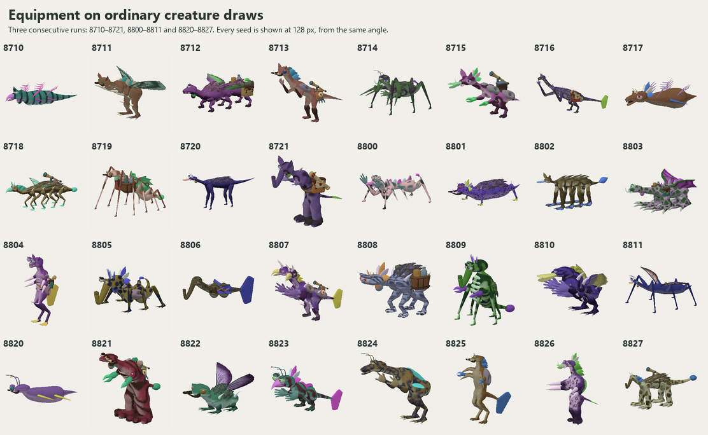

Open **Body plan → Equipment** to choose the load, slide it along the spine, change its size and colour, move it to the other side or wrap it towards the back. **Reroll packing** varies the packed goods, dispatch angle or telescope pitch while keeping the selected kind. **Shuffle → Equipment** draws a load against this creature's existing arms and wings. The same controls are available to an agent. For example, `{"op":"steerCreature","set":{"equipment":{"kind":"courier satchel","station":0.38,"size":0.95,"side":"left"}}}` equips the current creature. Setting `equipment` to `null` removes the load.

The hardware has its own geometry and attachment hierarchy, including working gaps through the buckle frames, a trade pannier with an interior shelf, a telescope objective and a folded dispatch. Saving, adjusting and exporting preserve the individual pieces. A new random load checks arm clearance, the actual wing surfaces and the recipe's remaining region budget. On a crowded upright torso the pack can face rearward to retain full size. The creature's existing anatomy stays intact.

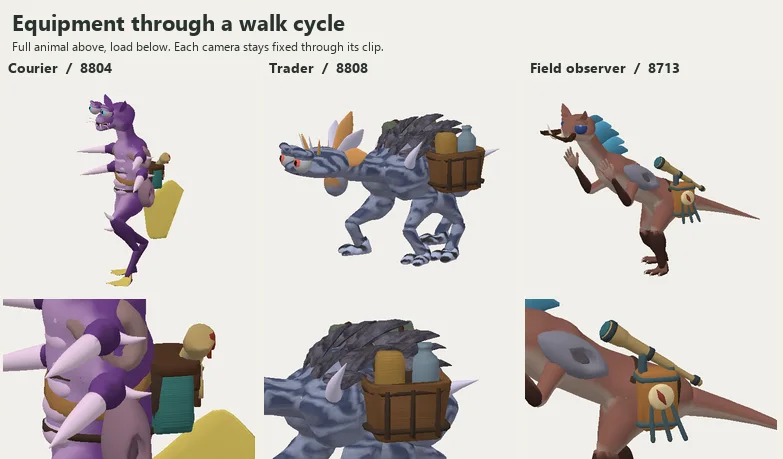

**Recognition at 128 pixels.** One independent visual model assigned a role from two views. The initial test yielded 9 first-choice matches in 12. After fitting the packs away from the arms and adding a courier sling and closed dispatch tube, it gave 13 matches in 14, plus one uncertain answer leaning towards the correct role. The final test with a sealed letter on the courier bag yielded 11 matches in 12. The judge recognized five of five couriers, including the two explicitly equipped transfer animals, but four were leans and the fifth was near-strong. Both traders were strong matches. It recognized all three bare controls, two strongly, and one of two observers strongly. It called the other observer, fresh seed 8821, bare. Five final choices were both correct and strictly strong. [Initial trial](media/creature-equipment-first.webp) · [Arm-clearance trial](media/creature-equipment-refit.webp) · [Final blind trial](media/creature-equipment-roles.webp)

The fresh run 8820–8827 produced two observers and six bare animals. To test transferring the courier kit, the first two eligible bare walkers from that run received an explicit courier request. The two transfers are counted separately from the natural draw. On 15 equipped game GLBs, all 149 equipment regions intersected their immediate carrier at rest and at each of four sampled Walk phases. The thin courier sling crossed one upper arm on seed 8804 and the wing root on transfer 8822. Facing away from the camera can hide working details. Repeated creatures across the reviews and a single judge limit the strength of the recognition result. [Draws, individual answers, export hashes and contact measurements](media/creature-equipment-trial.json)

## A courier presents its dispatch

In **Body plan → Equipment**, choose **Courier satchel** and set **Dispatch tube** to **Offer**. The animal takes the sealed tube by its metal handle and carries it beside the hip. Play **Offer dispatch** under **Motion** to see the arm extend towards a recipient and return. The 2.31-second clip exports with the game mesh. The endpoint is a saved pose named **Present dispatch** that you can adjust joint by joint. **Packed** returns the case to the bag. Creatures with pincers, spikes or a single finger keep their dispatch in the pack. [Open the editable seed 8716 recipe](../examples/creature-dispatch.form.json)

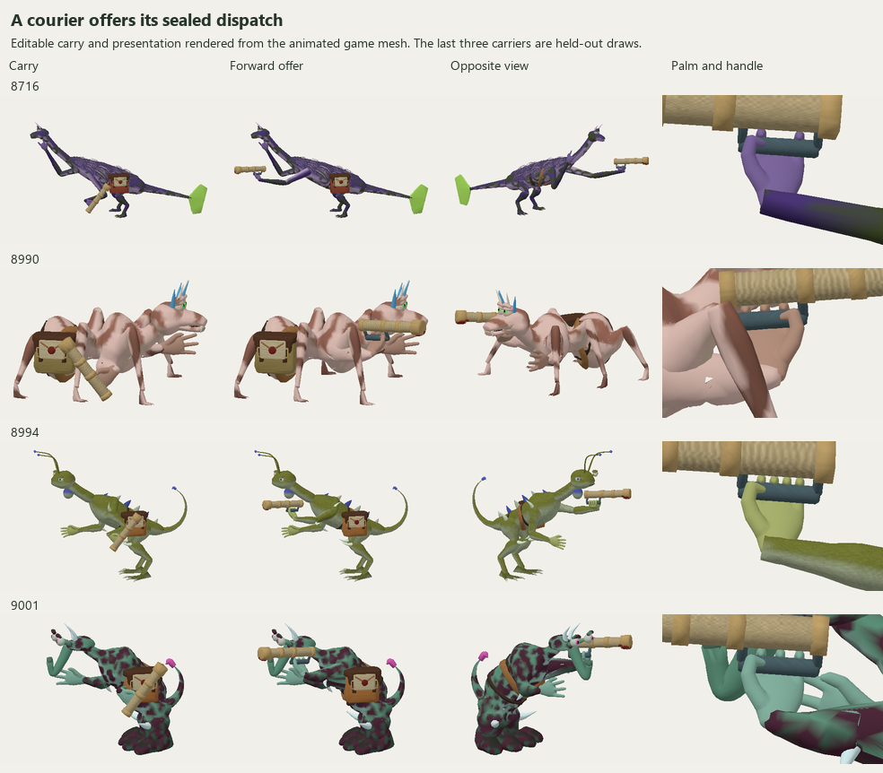

An earlier version simply raised the case. In a blind comparison, a reader picked the intended action on one of five animals. The vertical cases next to long legs resembled planted staffs. Moving the handle towards the rear of the tube let the seal extend beyond the hand. The revised rest pose tucks the case at the hip and the animated arm extends outwards and forwards. A fresh reader picked all five action sides and both unchanged controls, with mixed confidence. They described a baton or club. The gesture is readable, while its use for carrying messages still depends on seeing the satchel and sealed envelope. [First blind comparison](media/creature-dispatch-first-blind.webp) · [Second blind comparison](media/creature-dispatch-blind.webp)

We exported eight grasp-capable creatures, including every eligible animal in the two fixed seed runs 8950–8973 and 8990–9001. The second block was untouched until after the pose change. All eight exported hands had thumb and finger contact with the middle rod across all 136 sampled poses. The least measured opposition between the thumb and its farthest contacting finger was 159.7°. Two controls retained pack-mounted tubes. The new sling route also cleared the previously observed upper-arm and wing-root intersections on 8804 and 8822 across rest and four sampled Walk phases. Seed 8990 still covers its muzzle with the tube from some angles. The clip starts with the case in hand and stops before a recipient takes it. [Export hashes, blind answers, mesh-contact method and remaining limitations](media/creature-dispatch-trial.json)

## Coat materials and limb colour

Open **Body plan → Hide and colours** to keep the animal’s base, accent, eye and marking colours while trying **Plumage**, **Pelt**, **Scutes** or **Wet skin**. **Try a coat for this anatomy** suggests a material using its wings, legs, back and snout. **Coat contrast**, **Pattern density** and **Reroll coat** steer the pattern. A creature with a plain coat still has its original markings and materials. An agent can apply the same change with `{"op":"steerCreature","set":{"skin":{"coat":{"family":"pelt","density":1.1,"contrast":0.75,"seed":9201}}}}`. [Editable pelt example](../examples/creature-pelt.form.json)

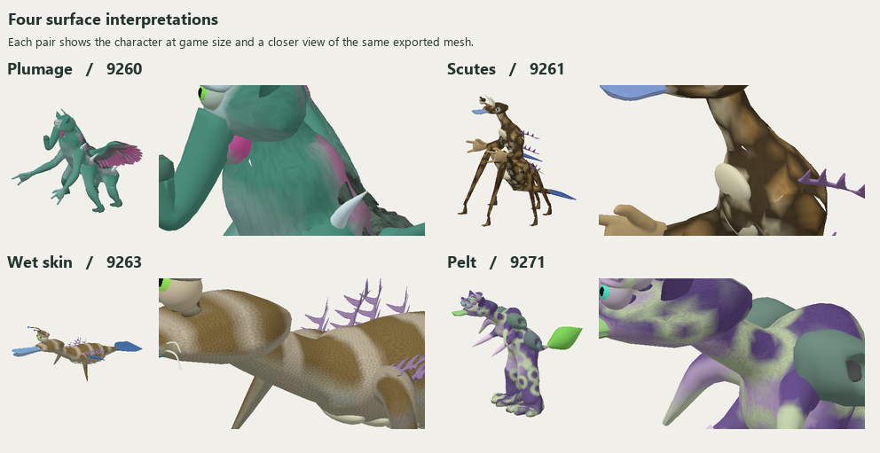

**Material remains an artist choice.** An initial attempt to harmonize the whole palette erased distinctions between creatures. Restoring each palette and giving the surface a physical scale fixed the most obvious wood grain. In the final trial, the reviewer favoured all three development plumage examples in close-up, twice by a lean. The only held-out pelt won its close-up, and the original won four of five held-out scute close-ups. Neither six-animal sheet produced an outright gameplay-size win for the added material. The family examples above include wet skin, which was absent from both consecutive blind runs. [Development comparison](media/creature-coat-pilot.webp) · [Unseen comparison](media/creature-coat-held.webp)

**Blend limb tips** carries the existing dark-tip colour down the thigh and shin or upper arm and forearm in proportion to the distance along the joint chain. New draws with dark limb ends use the fade. Saved plain plans keep their earlier colour transition, and the checkbox switches either treatment. In a separate blind comparison with the rest of the body unchanged, readers preferred the fade in four of six pilot cases and three of four new cases. Across 47 sampled knees and elbows the median colour difference between adjacent sections fell from 35.72 to 15.47 on an 8-bit RGB scale. Seed 9353’s markings increased its measured gap. The hard border on 9105 also helped one reader count its thin legs at a distance. All 20 limb-test game exports retained one skinned triangle primitive and one material. [Limb comparison](media/creature-limb-colour-pilot.webp) · [Unseen limb comparison](media/creature-limb-colour-held.webp) · [Answers, metrics, export hashes and limitations](media/creature-coat-trial.json) · [GLB limb-colour measurement script](../scripts/measure-limb-colour.py)

Every limb is staged along its length and coloured by its anatomy. A fleshy leg or arm carries its muscle near the root, narrows to tendon above the foot or hand and stands out again at the knee, hock, elbow or wrist. It is paler on its inner face, darker in the crease of the joint and darker towards the foot, most on a hoofed leg. A bird leg has a full drumstick and a bare shank: below the joint the hide turns darker and greyer, like horn. An arthropod leg swells in the femur, pinches at each hinge and tapers to its tip, with a pale membrane at the joint, a darker far segment and a dark tip. These layers lie over the coat, the markings and the dark limb ends of the plan, so they need no setting of their own, and `muscle` on a limb group still scales the swelling.

## Body shape before equipment

The contact sheet shows the first twelve draws from seed 8710. Each animal uses the same 3D editor and recipe grammar. The two pictures per animal are renders of its skinned game GLB at 128 pixels, with height measured from the mesh. The purple six-legged walker, seed 8712, has space between its knees and its head reaches ahead of the flight muscles. Seed 8719 keeps ten legs and a pair of wings on a raised thorax. Seed 8721 carries its trunk forward of its planted hind legs.

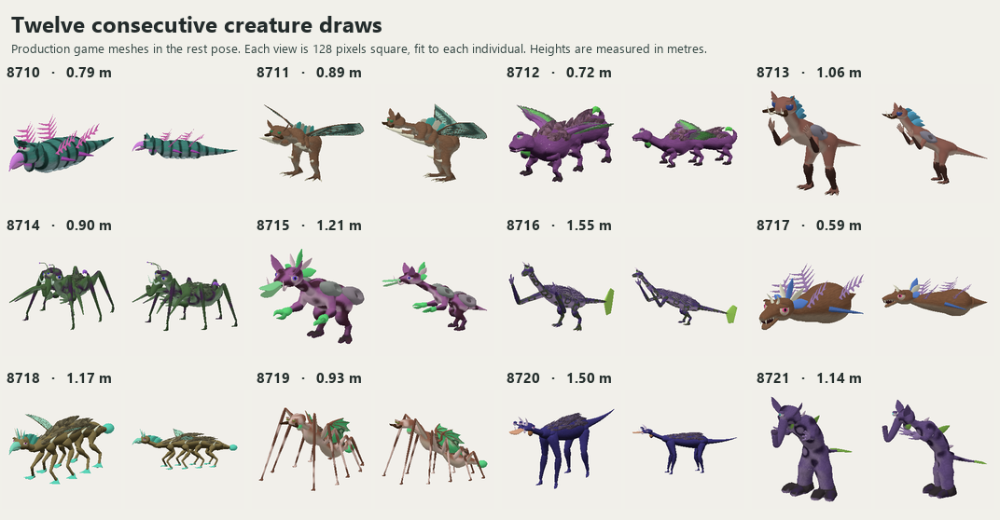

**Steer the anatomy.** Change head shape and feeding apparatus in the body plan. The beak hooks over a shorter lower jaw. The bill spreads towards the tip. Gape opens either lower jaw or separates the paired cutting mandibles. A proboscis can carry two recessed nostrils. The eye and crest roots follow the sculpted skull. Change a leg's end and digit count to reshape its contact surface. A hoof has two weight-bearing lobes, a talon has splayed digits, and a paddle joins its toe rays with a scalloped membrane. Cages, joints and nails remain individually accessible where they have their own regions. Previously saved plans use their original anatomy until explicitly steered with `{"op":"steerCreature","set":{"anatomyRevision":2}}`.

**What changed at game size.** In an initial blind review of twelve pairs, an independent visual model clearly preferred three new feeding shapes and two earlier foot shapes. The new version appeared on the left in nine pairs. The reviewer correctly called facing direction throughout except for one ambiguous prior version. Across three fixed angles, the median distance between prior and revised visible head masks was 24.1%, compared with 45.4% for foot masks and 5.0% for the whole outline. An individual toe shares its foot's mesh region. The average number of foot regions showing at least two pixels fell from 7.3 to 6.9. [First blind comparison](media/creature-anatomy-blind.webp)

A second review compared body proportions with two views per animal, six candidates on each side and two identical controls. The judge strongly preferred all three previously flagged cases and another crowded walker. On the next twelve consecutive seeds, one changed walker earned a strong preference and a forward-leaning pillar biped earned a lean. Two colour-only comparisons and both identical controls tied. One small change to an already-lowered grasper leaned towards the prior pose, which the production sampler retains. Pair framing and changed animal size influenced the apparent clearance on two winners. The strongest remaining defects were repeated legs, broad upright masses, merged features on a hunched head and a tiny head above overlapping wings and legs. [Balanced blind comparison](media/creature-posture-blind.webp)

Across the first twelve game exports, distal feet intersected their animated parent at all 44 rest and 176 sampled walk positions. The earlier meshes reached 30 of 44 and 120 of 176. The next twelve exposed two further mechanical defects. A stance adjustment separated the two paddles on seed 8730, which had intersected each other in all five samples. A change to the ankle collar connected two previously floating pointed feet on seed 8722. After those repairs the next twelve reached 50 of 50 rest and 200 of 200 walk contacts. These counts cover rest and four phases of Walk. [Per-seed distances, judge answers, GLB hashes and contact method](media/creature-anatomy-trial.json)

## Earlier growth and wing cohort

Bird-like body plans can grow contour plumage. Each overlapping feather follows the back and flank as a separate editable cage. Its shaft and vane pattern follows edits to the cage and survives the game export. The back growth controls set its height, spread and number of rows.

The twelve creatures below are consecutive draws from seeds 8710 through 8721. Each panel shows a skinned game GLB and reports its actual height. The camera fits each animal separately. The batch includes aquatic gill fans, overlapping keratin shingles, paired resonating sacs, a shag mantle, and two older dorsal ornaments.

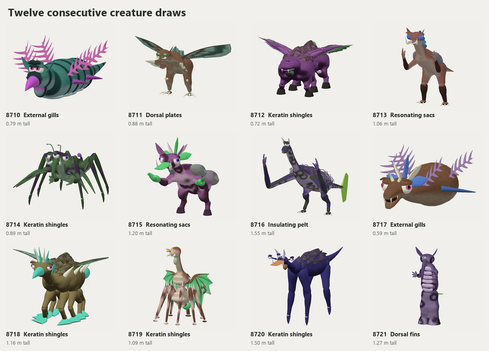

The next four comparisons hold the body plan and camera fixed. Seed 8720 grows 25 shingle regions, of which 24 cover at least 12 pixels in the rear three-quarter view. Seed 8710 grows branched gills from four sockets. Seed 8715 has a separate, recessed membrane in each resonator. Seed 8716 combines rooted guard hairs with short underfur that stays visible after mesh reduction. All 1,023 sampled gill, resonator and shingle attachments on the first three of those animals intersected their carrier across rest and the sampled animation frames. [Seeds, controls and export measurements](media/creature-back-growth.json)

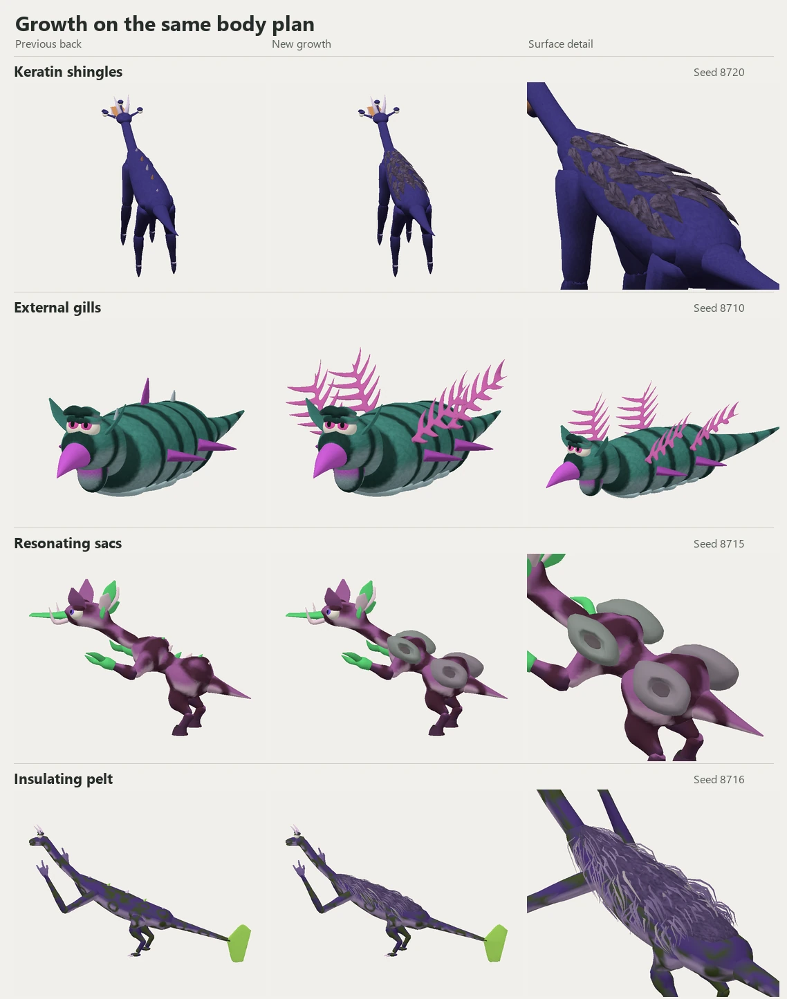

The flight comparison uses the same seed-8712 body, colors, shingle field and camera in every panel. Its random draw produced feathers. The other three panels change the wing group's structure through the same body-plan operation used in the editor. The four exported Fly clips run at matching stroke phases so the membrane, feather slots and vein cells are easy to compare.

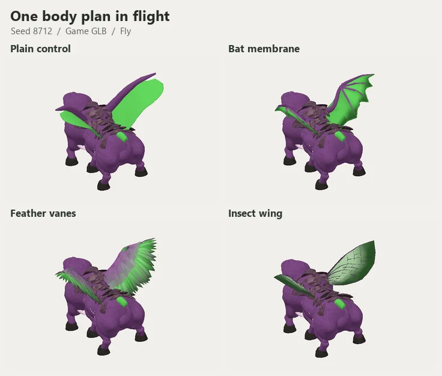

## Earlier preset gallery

The following sheet records the first eleven body-plan presets, before structured wings and surface growth were added.

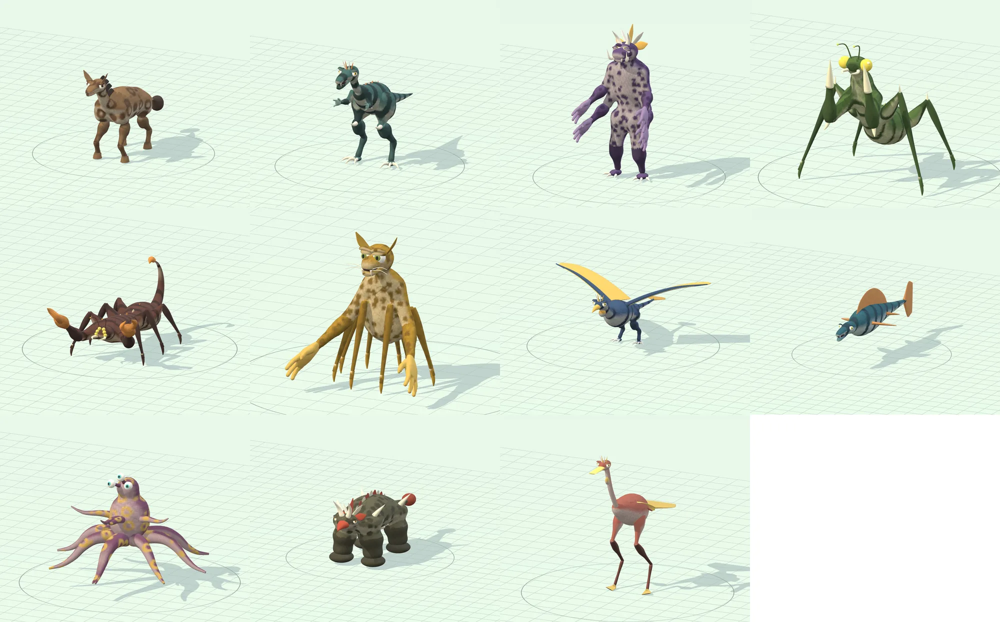

The eleven animals above are the built-in starting points. Each one is an original design with a way of living that explains its shape: a grazer with eyes on the sides of its head, a pursuit runner balanced by its tail, a four-armed trader, an ambush hunter with a raised forebody, a six-legged crawler with pincers and a sting, a radial walker on ten legs, a glider, a swimmer, a drifter with a ring of arms, an armoured browser and a stilt-legged wader. Load them from **Forms → Load an editable study**, group *Creature body plans*.

## Use it

**Start.** In **Forms**, set the body plan to *Creature · free body plan* and choose **Generate new form**. The **Creature body plan** panel opens beside the model.

**Change the plan.** *Start from…* picks a starting animal and *Shuffle* draws a new whole creature, posture and limbs, head, tail and details, or colours. Below that:

- **Spine and posture.** Length, thickness, the tilt of each end (level, raised forebody or upright), arch, ride height and five girths from hips to shoulders.
- **Limb groups.** Legs, arms, wings, fins or tentacles, one to six pairs each, on both sides or one. A group is placed by the station of its first and last pair along the spine. Legs choose their joints (mammal, bird, insect or pillar), sprawl, a fan around the body for radial stances, and a foot. Arms end in a hand, a pincer or a spike. Tentacles fan around the body and curl at the tip.
- **Wings.** *Built as* chooses what a wing is made of. A *bat* wing is a jointed arm with two to five long fingers, skin stretched between them with a scalloped trailing edge, and a thumb claw. A *feathered* wing has four to twelve primaries on the hand, secondaries on the forearm, tertials, rows of coverts over the arm and an alula. An *insect* wing is a stiff film with three to eight main veins, cross veins that close it into cells and a dark cell near the tip. Each has its own controls: the number of fingers, primaries or veins, the fold of the arm, scallop depth, slotted tips or a lobed margin, and how pointed the tip is. A wing pattern (tips, bars or an eyespot) and a variation seed finish it. *Plain* is the smooth wing of earlier body plans, and a plan saved without a structure still builds it.
- **Head and neck.** One to three heads, neck, skull, six mouth parts, jaw gape and teeth, nostrils, up to eight eyes, stalks, lids, brow and a crest.
- **Tail, back and details.** Choose among seven tails and the earlier dorsal ornaments, or open *Along the back* and select *Shingles*, *Gill fans*, *Drum sacs* or *Shag mantle*. Count changes rows or paired organs, height controls relief, and spread changes coverage around the trunk. *Reroll growth* draws a new local pattern. Individual shingle tips can also be locked or rerolled. Eight additional details include a mane, tusks, spurs and belly plates.
- **Hide and colours.** Scales or plain hide, a pale underside, dark limb ends and a marking pattern. Reticulated markings trace the boundaries between pigment patches. Marbled markings curve back across the flanks. The marking colour, angle, coverage, spacing and seed work across limbs as well as the trunk.

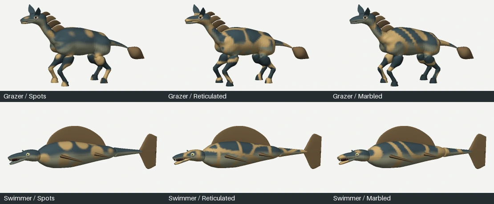

Each change is one undo step. A leg always reaches the ground. A legless body with fins, wings or tentacles floats at its ride height.

**Pose several limbs at once.** Open **Pose joints…**, select a joint of a limb and choose *Pose together*: this joint only, left and right together, or all limbs of that kind. A turn made on one limb is carried to the others, mirrored across the body and turned around it for a radial stance. *Guide limb tip* moves a foot or hand and solves the joints above it. *Keep the other feet planted* holds every other foot on its spot while the body or one limb moves. Save the pose under a name and it plays and exports as a clip.

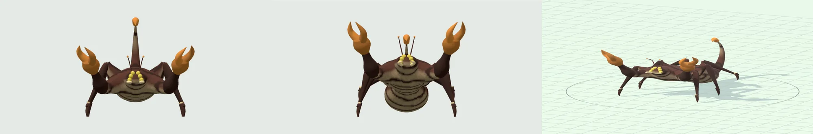

**Steer it with AI direction.** The request sent to the assistant carries `creaturePlanInstructions` and the option lists. Two operations work on the plan:

```json
{"op": "buildCreature", "preset": "Six-legged crawler", "plan": {"head": {"eyes": 6}}}
{"op": "steerCreature", "set": {"setLimbs": [{"index": 0, "pairs": 4}], "addLimbs": [{"kind": "wing", "pairs": 1, "from": 0.75}], "tail": {"kind": "club"}}}
```

A wing group takes `structure` (`plain`, `bat`, `feather` or `insect`), `ribs`, `bend`, `notch`, `point`, `pattern` and `seed`, for example `{"setLimbs": [{"index": 1, "structure": "bat", "ribs": 5, "notch": 0.8}]}`. Changing the structure resets `ribs` to the default of the new one.

`buildCreature` starts a new animal from a preset, a partial plan or both. `steerCreature` changes part of the current plan and keeps hand edits on everything the change leaves alone. `spine`, `head`, `tail`, `back` and `skin` merge field by field, and `setLimbs`, `removeLimbs` and `addLimbs` edit limb groups in place.

## References

The goals come from published work on Spore's creature creator and from creatures that Maxis or the Sporepedia picked out.

- Hecker, Raabe, Enslow, DeWeese, Maynard and van Prooijen, *Real-time Motion Retargeting to Highly Varied User-Created Morphologies*, SIGGRAPH 2008. [Paper and notes](https://chrishecker.com/Real-time_Motion_Retargeting_to_Highly_Varied_User-Created_Morphologies) · [doi 10.1145/1360612.1360626](https://doi.org/10.1145/1360612.1360626). The source for limb-relative motion that survives any leg count.
- [IEEE Spectrum, *Engineering Spore*](https://spectrum.ieee.org/engineering-spore), on the spine-and-parts creator.
- [Maxis Captain Postcard Challenge winners](https://www.spore.com/what/ga_captains), with the judges' notes on extra hands, repeated armour and aquatic builds.
- Development target: [Breen](http://www.spore.com/sporepedia#qry=sast-500314050878) (Sporepedia 500314050878), an upright creature on ten legs with long arms.
- Held-out target: [Abaoth by dragonmaker94](http://www.spore.com/sporepedia#qry=sast-501125203656) (Sporepedia 501125203656), a floating maw surrounded by tentacles.

Reference images, models and the creatures built to match them stay on the author's machine. This page cites them by address and reports what was measured.

## Measured results

Measured on 23 November 2026. Browser measurements ran in headless Chrome on hardware WebGL (ANGLE, NVIDIA RTX 5070 Ti, Direct3D 11) against the workshop bundle, driving only public controls. [Raw values](media/creature-plans.json).

| What | Result |
| --- | --- |
| Unit tests in the repository | 156 of 156 pass (`npm test`) |
| Body plans that build a valid, replayable form | 11 presets and 300 drawn plans, all valid |
| Feet on the floor at rest | every leg style × posture × foot combination tested, within the test's tolerance |
| Walk cycle | every preset with legs: each foot lifts, lands and stays planted in stance, including the six- and ten-legged plans |
| Plan change after hand edits | sculpted tail, repainted head, added horn, removed ear and a saved pose all survive adding a pair of legs and lengthening the neck |
| AI operations | `buildCreature` and `steerCreature` accepted through the same proposal reader the workshop uses; four refusals checked |
| Time to rebuild a preset in the editor | 0.45 to 1.18 s (27 to 76 parts) |
| Pose scopes offered on a crawler leg | this joint only · left and right together · all 6 legs; other feet planted by default |
| Export of the posed crawler | 6.43 MB GLB in 1.0 s; 85,960 triangles, one skeleton, six clips including *Pose · Rear up* |
| Exported crawler in the separate player | Walk moves vertices up to 0.281 m with the lowest vertex at 0.003 m; the saved pose moves them 0.322 m with the lowest vertex at 0.003 m |

The four-phase sheet below records the earlier movement study with the original plain wing. The current structural Fly comparison appears in the gallery above.

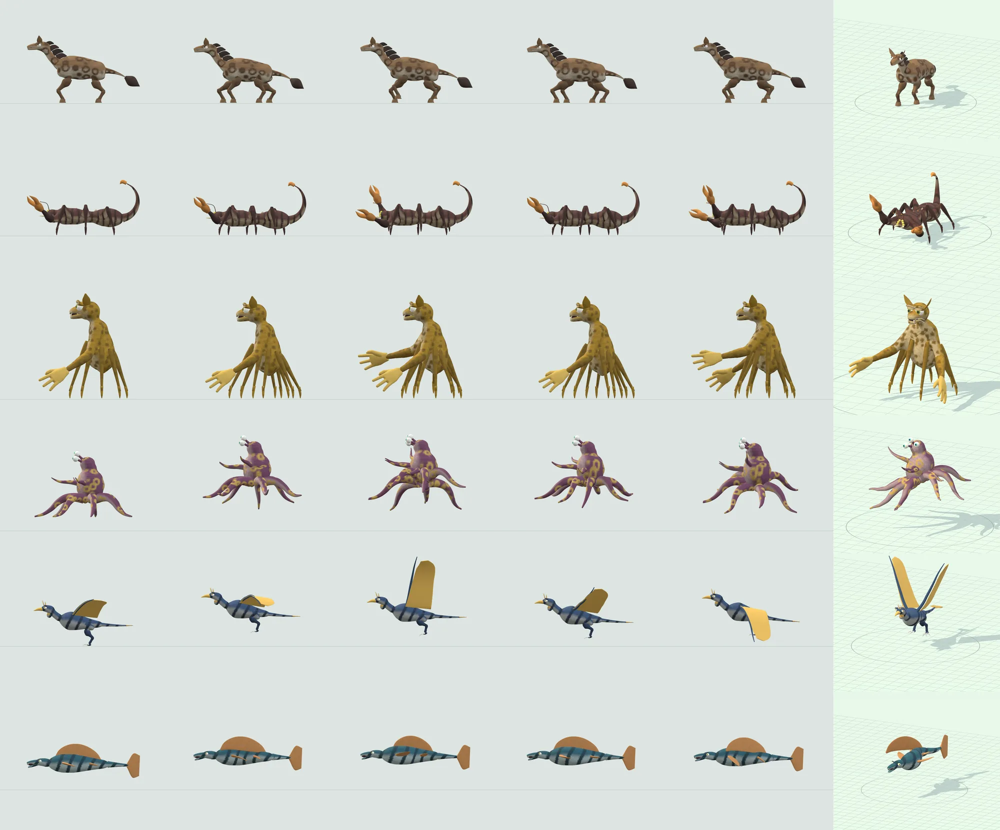

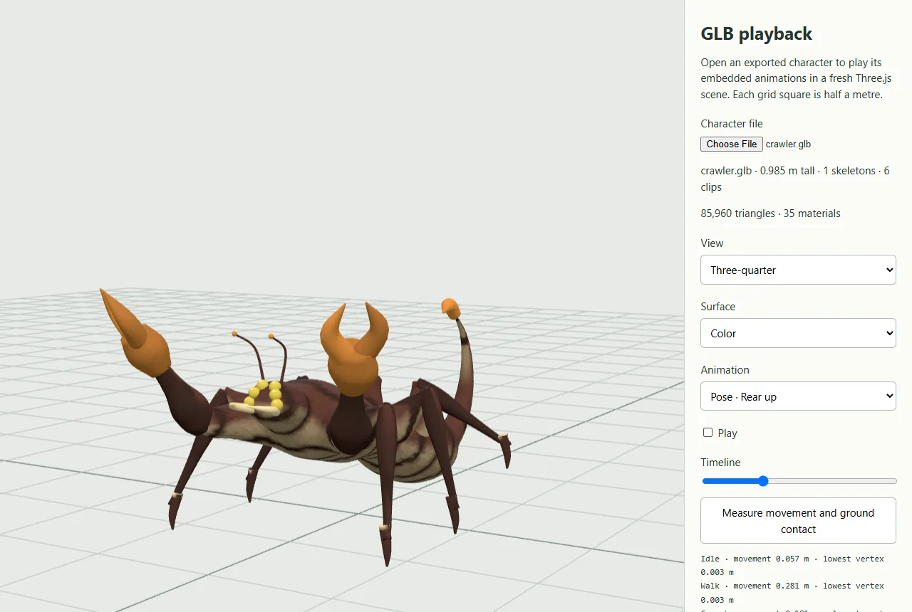

[Editable crawler](../examples/six-legged-crawler.form.json) · [Exported crawler](../examples/six-legged-crawler.glb)

### Wing structures

Measured on 23 November 2026 with the triangles of the built and skinned creatures, drawn one-sided by the native diagnostic rasteriser on hardware OpenGL (NVIDIA RTX 5070 Ti). The rows marked *browser* come from one run of headless Chrome on hardware WebGL (ANGLE, NVIDIA RTX 5070 Ti, Direct3D 11) against a private build of the workshop, driving only public controls, with no page errors.

| What | Result |
| --- | --- |
| Wing tests | 6 of 6 pass (`node --test character-view/wing-surface.test.js character-view/creature-growth.test.js character-view/creature-anatomy.test.js`) |
| Triangles in one wing | bat 1,652 to 3,512 · insect 3,884 to 7,658 · feathered 4,510 to 11,854, from the fewest to the most fingers, veins or primaries. A plain wing is two sweeps. |
| Regions | every structure uses two regions a wing, as the plain wing does. The glider has 42 parts with each. |
| Pixels with no surface facing the camera | six views each of seven creatures: none for bat and insect wings beyond 0.04 % in one view from below, at most 0.11 % for feathered wings |
| Flight | the surface is weighted to the joints of its own arm. Over 41 poses the tip of the surface stays within 4 % of the span of the tip of the arm, and the lowest vertex of the glider stays 0.56 to 0.62 m above the floor with every structure. |
| Bodies the wings were not tuned on | six-legged crawler with insect wings, upright trader with bat wings, grazer with feathered wings, hunter with two pairs of insect wings, drifter with bat wings: all build, fly and stay above the floor |
| Live handle drags | girth and limb-station drags keep the wing unchanged and only move it, so the warp shows them exactly |
| Skinned GLB | glider with each structure exports with 63 joints and six clips (3.4 to 4.7 MB) and plays *Fly* when read back with three's loader |
| Drawn body plans | of 4,000 random seeds, 1,088 wing groups: 553 insect, 298 feathered, 237 bat. An insect-like animal mostly draws insect wings and a beaked one feathers. |
| Panel, *browser* | *Built as* offers Plain, Bat, Feather and Insect and swaps the controls below it. Each of 20 changes rebuilt the glider in 0.36 to 0.52 s, at 42 parts with every structure. |
| Wings on a wingless body, *browser* | *+ Wings* on the six-legged crawler adds insect wings (62 parts) |
| Shuffle, *browser* | 4 of 16 whole-creature shuffles drew wings, all four insect |
| AI request and proposal, *browser* | the exported request carries the wing instructions and options. A `steerCreature` proposal setting bat, five fingers, scallop 0.85, an eyespot and seed 77 was reviewed and accepted, and the panel showed those values. |
| Game export, *browser* | glider with plain, bat, feathered and insect wings: 24,004 · 23,996 · 24,000 · 24,006 triangles, one material, 1.98 · 2.19 · 2.25 · 2.03 MB, each in 1.1 to 1.3 s. Full feathered export: 67,734 triangles, 4.39 MB. |
| Exported files in the separate player, *browser* | all six files load with one skeleton and six clips. *Fly* moves vertices 1.49 to 1.54 m on the glider with the lowest vertex 0.57 to 0.66 m above the floor, and 1.21 m and 0.55 m on the winged crawler. |
| At gameplay distance, *browser* | drawn live in a 560 × 252 px stage the flying glider covers about 92 × 101 px. In colour all four wings are told apart at that size. In clay the bat's scallops and the feathered wing's fringe show, and the insect wing looks like the plain blade. |

## The held-out trial

The protocol was fixed before looking: freeze the creature code, record its hashes, then take the first creature in the Sporepedia's featured list as the target and build it through the panel alone.

**Frozen attempt (the held-out result).** Built with 57 panel actions. The result has the dark body, eight small eyes and 38 tentacles of the target. It misses the features that make the target recognisable: there was no way to open a jaw or add teeth, the body lay on the floor because only legs could lift it, the tentacles were straight and left the body in comb-like rows, and the fourth group of tentacles was refused by the limit of 48 joined skin regions. Likeness as judged by the author: about 30 of 100.

**After the trial (not held-out).** Those four failures became changes: a jaw with gape and teeth, floating for legless bodies, tentacles that fan around the body and curl, and a skin that leaves the smallest pieces separate past the join limit. A second build with 64 panel actions floats, has 22 teeth in an open maw and 46 curling tentacles in four fans. The author judges it at about 55 of 100. It still lacks the target's long needle fangs, arms that leave the body upward and downward as densely as sideways, and its pale tips. This second build was made with knowledge of the target and counts as development, not as a test.

**Development target.** Breen was rebuilt with 28 panel actions: an upright body, ten jointed legs in a fan, long arms with large hands and a wide head with large eyes. Its legs come out as stilts where the original's are short and finger-like.

## How far this is from the best creature creators

The aim is 80 of 100 against the best of Spore's creature creator, with The Sims 4 and Dragon's Dogma 2 as the bar for finish. These scores are the author's judgement after the work above. They are estimates, not measurements, and an art review should replace them.

| Aspect | Estimate | Why |
| --- | --- | --- |
| Freedom of body plan | 65 | Any posture, eight limb groups of five kinds, radial stances, several heads. One spine only, limbs leave the flanks, no branching bodies. |
| Direct manipulation | 40 | The plan is edited with sliders in a panel. Spore drags parts and vertebrae on the model. Individual regions can still be dragged with the workshop's sculpt tools. |
| Parts and detail | 45 | 6 mouths, 5 crests, 7 tails, 4 back rows, 8 extras, 6 feet. Spore offers over two hundred parts with their own morph handles. |
| Skin and paint | 40 | Four patterns, a pale underside, dark limb ends and a scale texture. No layered coat and detail paint. |
| Movement of any morphology | 55 | Walk, idle, crouch, reach, swim, fly, slither and coil for any plan, with planted feet. Far fewer behaviours than Spore and no gait variety by size or leg count. |
| Posing | 85 | Paired, grouped and radial posing, limb-tip guiding and planted feet, saved as clips. Spore's creator has no posing. |
| Export | 80 | Skinned GLB with clips that plays in a separate Three.js scene. |
| Finish of the rendered animal | 45 | Coherent anatomy and colour zoning, but soft detail and visible seams. |
| **Overall** | **about 55** | Short of the 80 target. |

## Limitations

- One spine. No branching bodies, no limbs growing from limbs, and limbs leave the sides of the body, turned by their fan.
- The joined skin is rebuilt on a grid of 72 cells, so teeth-sized detail blends away and markings on it are coarser than on separate pieces. At most 48 regions join; past that the smallest outer pieces stay separate with a visible seam.
- Dark limb ends start at a joint, which leaves a hard edge on thick legs.
- Flight now reserves clearance for the length of the wing. Over 81 poses, the glider's lowest skinned vertex stayed 0.63 m above the floor. A low-bodied variant with 2.5 m wings angled down 24° went from 0.55 m below the floor to 0.40 m above it. These measurements use the test rig. The motion sheet above predates the clearance change. Swimming still bends the body only slightly.
- A wing surface is opaque and coloured per vertex, because the game export uses one material. Insect wings are a pale film, not a transparent one. Feather vanes are smooth blades without barbs.
- A wing is one arm chain of four joints. Fingers and feathers do not fold or spread on their own, so a wing at rest is the flying wing held at another angle. A wing swept far back turns to lie against the flank, and its feathers then point up and back.
- The surface of a wing is a region of its own with a joint that carries nothing. Posing that joint has no effect; pose the arm.
- Feathered wings are the heaviest. In the 24,000-triangle game export the feathers and coverts keep their outline but lose their separate layers up close.
- Wing patterns are coarse: bars and eyespots read as dark blotches from the front, not as drawn markings.
- At the workshop's default three-quarter view a level wing is seen nearly edge-on, so the structure shows best from above, behind or in flight.
- Tentacles curl but do not grip, and they move with the tail's motion, not a motion of their own.
- A plan change keeps hand edits only on regions the change leaves alone. A region the change reshapes takes the new shape and keeps its paint.
- Choosing a preset or shuffling the whole creature starts a new animal and drops earlier hand edits and poses.
- The held-out trial is a single creature, judged by the author.

## Reproduce

```
npm test
node --test character-view/creature-plan.test.js character-view/limb-pose.test.js
node --test character-view/wing-surface.test.js character-view/creature-growth.test.js
node --test character-view/creature-dress.test.js
```

The plan grammar is in `character-view/creature-plan.js`, wing surfaces in `character-view/wing-surface.js`, families and palettes in `character-view/creature-families.js`, worn layers in `character-view/creature-dress.js`, its panel in `character-view/creature-plan-editor.js`, multi-limb posing in `character-view/limb-pose.js` and the study list in `examples/creature-studies.js`.

### Ears, muzzles and livery

An ear crest can grow lance-shaped, swept, tufted, fan or lop ears. A muzzle can take a feline, canine, grazing or rooting profile. Insect legs can grow a shield at each attachment to the trunk. The ear, muzzle and socket choices can also be applied to a saved creature through its body plan.

Worn layers can carry a heraldic device. The device follows each garment panel on the fitted body and takes the colours of the livery. Plans that omit the device retain plain panels.

Contour plumage is an editable back covering on the heron, stilt, runner, terror bird and feather-winged bird. Each vane is a closed cage with a raised shaft and barred tip. Count sets the rows, height sets the lift and spread sets how far the feathers wrap around the flanks. Trunk straps fit over their thickness.

The Face marking control places an eye stripe, pale facial disc, pair of cheek flashes or forehead blaze on each skull in the hide's own colours. The pattern turns with the head and scales with its axes. It can be removed independently of the rest of the coat.

New warden outfits fit a breastplate and hanging waist guards to an upright chest. Four-footed wardens wear barding along the back. Saved outfits retain the cut in their plan. The metal guards carry their own surface coordinates for wear and roughness. Hooked beaks and long bills have a waxy base, a polished tip and a cutting edge, with a nostril when the head calls for one.

### Bills and coats

On a beaked head, **Bill profile** changes the keratin silhouette. Spear tapers to a straight point. Spoon narrows at the stem and widens at the tip. Crusher has a deep, short body. Shear overlaps the tip of the lower bill, and Scythe curves along its length. The jaw opening still controls the gap. Ordinary species draw these profiles according to their feeding family.

**Grade back and throat** blends a dorsal mantle and a throat patch into the chosen coat. A bird can have a coloured bib, a grazing animal a dark saddle, and an aquatic animal a light underside. The animal keeps its editable base, accent and pale colours, and its markings sit over the graded coat.


The **Flank marking** control adds a lateral stripe, a saddle or a row of ocelli (eye spots) along the torso. The secondary marking follows the spine from hip to shoulder and uses the accent and pale colours. The base hide and its smaller spots or bands remain visible underneath. Choose **None** to remove the marking. New creatures can draw one on an exposed torso. Existing saved plans acquire one only when edited.
