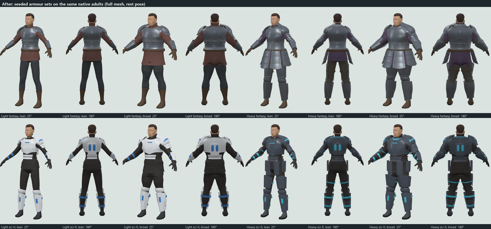
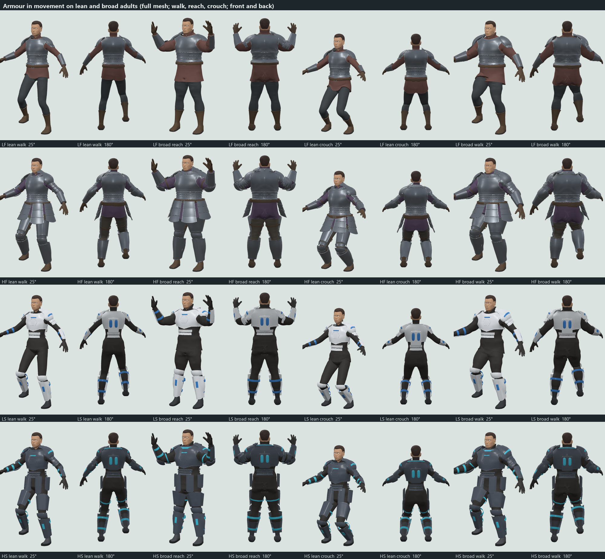
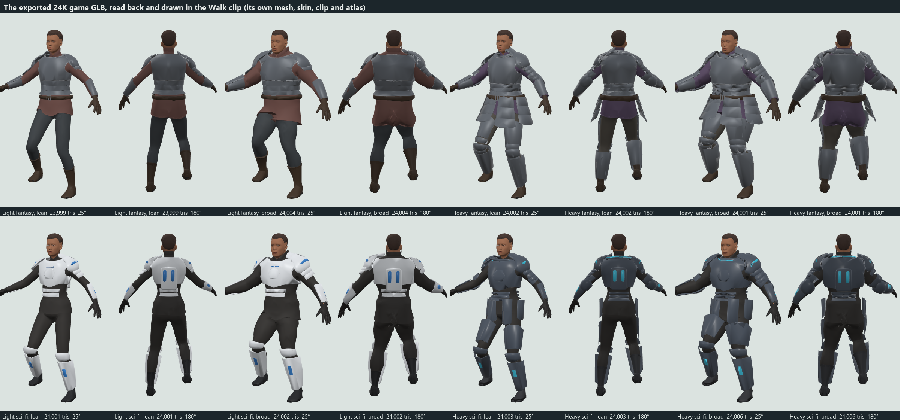

# Armour for the adult surface

`character-view/human-armour.js` adds wearable armour to the adult human. Its five pieces are ordinary pieces of a
tailored outfit ([human-tailor.js](../character-view/human-tailor.js)): they are worn over the clothes, saved in the
same recipe, skinned to the same joints and exported in the Full and the game file like any other garment. All of
it is generated from the body it is given, so one set fits a lean person and a broad one.







## Wearing a set

In the editor, open **Appearance → Tailored outfit**, choose a look under **Armour set** and press **Wear armour
set**. **Another variation** draws the same look with another seed. The set is laid out as pieces in dressing order:
the undergarment first, then the plates. Open a piece to change it, move it or remove it.

A saved look can name a whole set in a few words:

```js
form.outfit = "Work clothes";
form.humanStyle = { hair: "Crop", armour: { look: "Heavy fantasy", seed: 12 } };
// Change single parts and keep the rest of the set; null leaves a part off.
form.humanStyle.armour.pieces = { pauldrons: { balance: "left only", size: 0.8 }, cuirass: { collar: "gorget" }, tassets: null };
```

- `look` is one of `armourLooks`: `"Light fantasy"`, `"Heavy fantasy"`, `"Light sci-fi"`, `"Heavy sci-fi"`.
- `seed` (0 to 999999) chooses cuts, proportions, the heavier side and the colours within the look. The same look
  and seed always give the same set.
- `pieces` takes any field of a piece below. Naming an armour piece the look leaves off adds it.
- `humanStyle.tailor.layers` written out piece by piece comes first when both are saved. Choosing a preset outfit
  puts the armour away, as it does tailored pieces.
- An assistant reads the same words from `humanArmourInstructions` in the editing brief.

`armourSet(seed, look)` returns the tailor layers directly, and `armourTailor({ look, seed, pieces })` returns them
for a saved look.

## The pieces

Every piece takes `color`, `trim`, `material` (`steel`, `leather` or `lacquer`), `room` in millimetres over the
clothes and a `seed` for its own small variations.

| Piece | Choices |
| --- | --- |
| `cuirass` | `build`: `fitted` (breastplate, pointed lower plate and waist lames), `segmented` (chest plate over bands) or `hardshell` (chevron chest shell, raised breastbone panel, separate belly and back plates with open flanks). `length`, `relief`, `lames`, `collar`: `open`, `gorget` or `ring`. `back`: `plain` or `pack`. |
| `pauldrons` | `cut`: `rounded`, `pointed` or `angular`. `lames` down the arm, `size`, `flange` (a standing neck guard), `balance`: `matched`, `left heavier`, `right heavier`, `left only`, `right only`. |
| `armguards` | `cover`: `forearm`, `forearm and elbow` or `whole arm`. `cut`, `balance`. |
| `legguards` | `cover`: `shin`, `shin and knee` or `whole leg`. `cut`. |
| `tassets` | `plates`: `front`, `front and sides` or `all round`. `cut`, `lames`, `length`. |

Put a top on before the cuirass: the plates take their room from whatever is already worn, and the cloth shows at
the neck, the arm openings and between the plates.

## How it is built

- **Cuirass.** A stiff shell is cut from the wearer's own surface like a garment and hung with room over the figure
  and the clothes. Its front is read as a height map, blurred by a fixed distance and raised only where the figure
  stands higher, so a breastplate is one even form over any chest. The shell is then divided into plates along
  lines measured on the finished shell.
- **Shoulders, limbs and hips.** Each plate is lofted round a tube that follows the limb and is measured against
  the skin and everything already worn, so a plate clears a sleeve, a boot shaft or the cuirass under it.
- **Seated shoulders.** A rounded or pointed shoulder is a spaulder. A shallow cop sits on the point of the
  shoulder. Narrow lames run from it towards the neck, each tucked under the one outside it, and down the arm, each
  tucked under the one above, so every lame shows a stepped edge. A leather tab with a buckle holds the top lame
  to the cuirass and a strap round the arm holds the lowest. `size` sets the reach of the cop and the lames,
  `flange` adds lames towards the neck. The `angular` cut keeps its faceted shell.
- **Openings.** The neck and arm openings of a forged or leather cuirass carry a rolled edge that follows the
  opening as one even line, also in the game file.
- **Plates are solid and rigid.** Every plate has an outer face, a wall round its edge and a lining under the edge,
  and all its points share one set of skin weights, so it moves as one piece and never stretches. Lames share their
  motion between the joints they span: shoulder lames step from the collarbone to the upper arm, waist lames down
  the spine, hip plates between the pelvis and the thigh.
- **Edges and relief.** Rolled or raised edges, a keel, grooves, studs and inlays are geometry on the plates, in
  the plate colour or the trim colour.
- **Materials.** `steel` is drawn as forged metal with soft darker and duller patches, `leather` as a hide with
  worn patches and `lacquer` as a smooth painted shell.
- **Game file.** The game export asks for the same plates from fewer, larger faces: the cuirass shell is not
  subdivided, plates have fewer rows and columns, and straps and edges in the plate's own colour are left out. A
  whole set is then 9,300 to 22,400 triangles instead of 47,000 to 96,000, which leaves the boots, hands and
  face their share of the file's fixed triangle count.
- **Sharing the game file.** The exporter (`optimizeForGame` in
  [game-export.js](../character-view/game-export.js)) reduces skin, clothes, hair, boots and plates as one surface,
  so the triangles go where a shape needs them: a plate or a boot built from few faces keeps most of them, and a
  densely built surface gives up the most. Each material keeps at least 70 % of an even share, which protects
  hands and hair. Eyelashes, eyewear, teeth, strand hair and feathers are drawn as built until the rest of the
  figure would get less than 8.5 % of its faces; they are then thinned together, to no less than 30 % of the file.
  On the winged messenger this takes them from 11,672 to 9,559 triangles, and the plates, boots and clothes get
  about 30 % more.

## Checks

`node --test character-view/human-armour.test.js` covers the pieces and their limits, repeatable seeds, the saved
look, sound skinned meshes on a lean and a broad adult, one skin per plate, the lighter game build and unchanged
ordinary outfits.

Measured on the lean and the broad study bodies in four looks and four poses (rest, Walk, Reach, Crouch), from
eight directions each: skin or cloth seen through a plate takes 0.00 to 0.18 % of the plate pixels, all of it at
plate edges by a wrist, an ankle or the neck. The game files hold 23,998 to 24,000 triangles with 69 joints and the
four clips.

`node --test character-view/game-export.test.js` covers the sharing of the game file: a plate of few faces beside
a dense surface, the floor of each material, and fibres and feathers that give only when the rest runs short.
Six winged figures (the saved messenger, heavy fantasy, heavy sci-fi, coiled and strand hair, a plain outfit) were
exported at 24,000 triangles and drawn beside their full files in Walk and Reach from two directions. Pixels where
the game file shows something else than the full file fell from 2.0 to 16.0 % of the figure to 0.7 to 11.5 %; on
the heavy fantasy set with wings from 5.1 to 10.5 % to 1.4 to 2.6 %. The straps the game build leaves out count
as differences in both.

## Breastplate inlay

The cuirass device control adds a moon moth, a heron, an oak or a compass on the chest. Its metal follows the layer's trim colour. The front and back of the plate have separate texture coordinates, which keeps the inlay on the chest through the single-material Game export. The four monochrome designs in `character-view/armour-devices.webp` are original image-generated artwork prepared for this project.

Segmented cuirasses carry fitted rivet rows on the waist plates. Leather versions have stitched fastening tabs with metal frames at the sides. The front and back share the same construction height.

## Limits

- The thigh plates cover the front and outside of the leg, and the back of the thigh stays cloth.
- A mail standard is three to five cells deep, as deep all round as its shallowest place over the shoulders allows.
- A mail shirt in a game file is drawn at the size its place in the atlas can carry, so its rings are soft there.
- A raised arm lifts the shoulder plates as a group, and the cloth of the armpit shows under them.
- At 24,000 triangles the narrow waist lames lose their crisp lower edge and read as bands.
- A figure with feathered wings, eyewear and a full heavy set is the tightest case. Its plates, boots and wings
  hold their shape in the game file, but the plates are flat-faced close up and studs and narrow edges are lost.
- Raised edges round the neck and arm openings of the cuirass follow the shell's triangles and are slightly uneven
  close up.
- The pressure-suit helmet belongs to its own outfit. A travelling mantle can be worn with a tailored armour set.

### Forearm and shin plates

The outer shell follows the measured taper of the forearm or calf. The greave arches over the foot and rises in front of the knee. Paired plates share a chart for the flutes, raised rims and studs in the exported normal and material maps.

### Shoulder mantle

A travelling mantle can be added to a tailored outfit over the armour. Its off-centre opening wraps one shoulder and leaves the opposite arm free. The yoke rests on the fitted neck, breastplate and pauldron before the fabric hangs down the back. The artist can switch the shoulder, adjust the drop, and choose the wool, facing and brooch colours. The salt-road warden wears it over the cuirass.


The **Mail standard** is a short mantle of mail that hangs from a leather band round the base of the neck. It is open at the throat, where a strap and buckle close it, and lies over the collarbones, the shoulders and the top of the breastplate. A brass course marks its hem. The mail is built from cells of two rings by four courses at real size (a ring every 11 mm), and every cell shows one small picture turned over at each cell line. The rings therefore keep tens of texels each in a 1024 game atlas, and a game file keeps every cell line. The artist can select it on the cuirass. The Salt-road warden wears it, and it occurs in ordinary fantasy armour draws.
