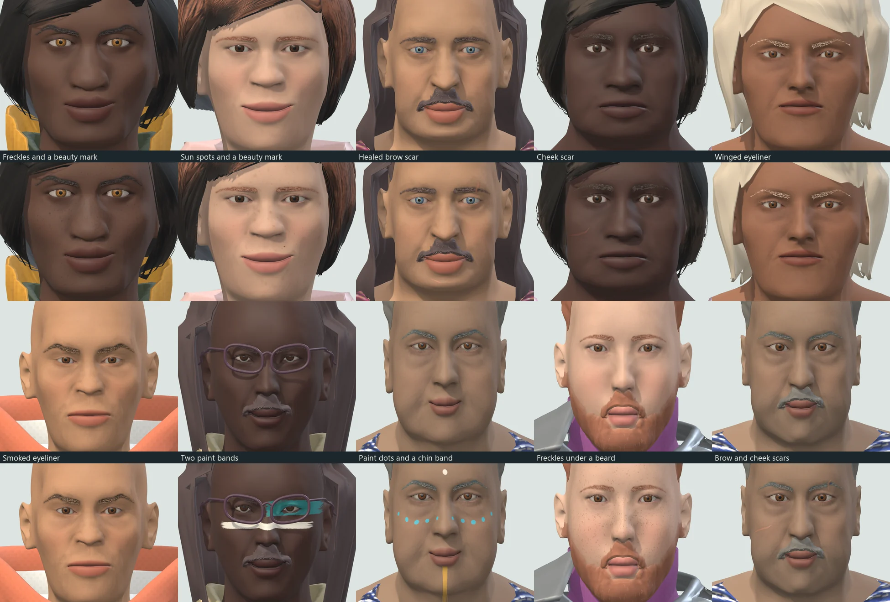

# Face marks for the adult surface

`character-view/human-face-marks.js` adds marks to an adult's face: freckles, sun spots, a beauty mark, a healed scar, eyeliner and graphic paint. A mark is a few numbers in the saved form, and it is painted into the same face textures as the complexion. The renderer, the materials and the export are the ones the workshop already has.



Each pair is one adult without marks and with them, in the workshop's colour view.

## What a mark is

`form.faceMarks` is a list of up to eight marks. A form without the field has a bare face, which is how every look saved before the feature reads.

```json
{ "kind": "Scar", "place": "Brow", "side": "Left", "strength": 0.55, "size": 0.5, "seed": 4 }
```

| Field | Meaning |
| --- | --- |
| `kind` | One of the eight kinds below. |
| `place` | A place listed for that kind. |
| `side` | `Both`, `Left` or `Right`, the wearer's own. On a place in the middle of the face, `Left` or `Right` keeps the mark to that half. |
| `strength` | 0 to 1. How many freckles and how dark, how raised a scar is, how opaque the paint is. |
| `size` | 0 to 1. Spot size, scar or stroke length, liner thickness. |
| `seed` | Unsigned 32-bit integer. Fixes the scatter of spots and the hand of a scar or a stroke. |
| `tone` | Optional `#rrggbb`. The colour of the mark itself on any skin. |
| `across`, `up` | Optional, -1 to 1. Move the mark outwards and upwards from its place. |
| `turn` | Optional, -90 to 90 degrees. Rotates scars and paint. |

| Kind | Places | Belongs to |
| --- | --- | --- |
| Freckles | Nose and cheeks, Cheeks, Nose, Whole face, Forehead | the person |
| Sun spots | Cheekbones, Temples, Forehead, Whole face | the person |
| Beauty mark | Cheek, Above lip, Under eye, Chin, Temple, Jaw | the person |
| Scar | Brow, Cheek, Above lip, Chin, Forehead, Nose bridge | the person |
| Eyeliner | Lash line, Winged, Smoked | the look |
| Paint band | Eyes, Nose bridge, Cheek, Forehead, Chin | the look |
| Paint streaks | Cheek, Under eye, Forehead, Chin | the look |
| Paint dots | Under eye, Brow, Nose bridge, Forehead, Chin | the look |

Nothing in a mark depends on the body frame, the bust or the skin. Any mark can be put on any adult.

Without `tone`, freckles, spots, beauty marks, scars and eyeliner take a natural tone worked out from the skin: freckles are a warm darker relative, a scar is paler than fair skin and pinker and lighter than dark skin, and liner is a soft near-black. Paint without a tone takes one of the ten colours of `faceMarkPalette`, chosen by the seed.

The same seed always gives the same mark. Freckles and sun spots are steady under editing: the seed fixes a long list of candidate spots, and strength decides how far down the list to go. Raising the strength adds spots between the ones already there. Changing the size or the tone leaves every spot where it was.

## Where to find it

- **Appearance → Face marks** in the workshop, after Eyewear. **New mark** adds one of the eight kinds with its defaults. The selected mark has Kind, Place, Side, Strength, Size, Move outwards, Move up, Turn, Tone, **Natural tone** (or **Palette tone** for paint), **Redraw** (a new seed) and **Remove**. Each change is one step of undo. Adding a mark switches the view to colour.
- **An assistant proposal.** The request carries `humanFaceMarkInstructions` with the kinds, places, sides, palette and usage. A reply sets the whole list with `setForm.set.faceMarks`, and `null` removes it.
- **A random adult.** `generatedHuman(seed)` sometimes gives the person freckles, sun spots, a beauty mark or a scar. Freckles are likelier on fair skin and sun spots on older people. `dressHuman` sometimes adds eyeliner (16% of looks) or paint (4%). A new look keeps the marks that belong to the person and replaces the worn ones. Over 3000 drawn adults, 42% had no mark, 22% had freckles, 16% a beauty mark, 13% sun spots, 7% a scar, 16% eyeliner and 4% paint.

```js
import { faceMark, validFaceMarks } from "./human-face-marks.js";

const form = { ...person, faceMarks: [faceMark("Freckles", 5, { strength: 0.6 }), faceMark("Paint band", 3, { side: "Left", tone: "#1f8a8a" })] };
```

## How it is painted

`human-complexion.js` makes three canvases for the face rectangle of the skin layout: colour, roughness and relief. `markFace(material, form)` paints the marks into copies of those canvases and hands the material back. `human-mesh.js` calls it on the head, in colour views only, so the clay view stays plain.

Marks are placed on the face and not on the texture. `human-face-chart.js` rasterises the neutral adult into the face rectangle once and records, for every texel, its position in millimetres (x to the wearer's left, y up from the eye line), its normal, and which texels are lip, eyelid, eye opening and wet lid rim. The landmarks come from the mesh itself: eye corners and lid margins from the stored lash lines, brows from the brow strokes, the mouth from the lip pigment. Each place is written in those coordinates, in units of the distance between the eyes.

- **Round spots lie on the surface.** A freckle is measured in the tangent plane of the skin under it, so it stays round on the side of the nose where the texture is stretched.
- **Lips and eyes are excluded per texel.** Every mark fades out over the lip pigment and over the eye opening and the wet rim of the lid. Eyeliner is the exception by design: it is measured from the lid margin and stops at the opening.
- **Tone is free of the skin.** The colour canvas multiplies the skin colour, so it cannot make anything brighter than the skin. When a mark needs to be brighter in some channel, the material's base colour is raised to a value that one byte of the canvas represents exactly, and the rest of the face is rescaled so bare skin still multiplies out to the skin colour. Pale paint works on dark skin and the head still meets the neck without a seam.
- **A scar changes the surface.** The line is paler, slightly glossier and has a shallow groove in the relief canvas, with a faint flush beside it. A scar through a brow parts the brow: `browParting` tests each brow strand's root against the scar and `human-face.js` leaves those strands out.
- **Facial hair covers pigment.** Marks that belong to the skin fade under stubble and a beard by the hair's own cover.
- **Worn marks lie on top.** Freckles, spots, beauty marks and scars are painted first and eyeliner and paint after them, whatever the order of the list.

The export bakes `material.color × map` for every head material, so the marks are in the exported GLB without any export change.

## Checks

Measured on 24 November 2026 in the built workshop in headless Chrome, with the default hardware renderer (ANGLE, Direct3D 11) and no page errors:

- **Controls.** Adding Freckles, a Scar, Eyeliner and a Paint band, and changing place, side, strength, size, turn, move and tone, each gave the status "… added." or "Face mark changed.". Undo stepped back one edit at a time. Removing the added marks returned a picture pixel-identical to the first one. The clay view showed no marks.
- **Proposal.** The exported request carried `humanFaceMarkInstructions`. A reply with three marks in `setForm.set.faceMarks` was shown for review and accepted, and the three marks were then listed in the controls.
- **Before and after.** 15 authored sets and 10 adults exactly as drawn were opened from saved forms, each without and with its marks, and captured at portrait size, at three-quarter and as a whole figure 360 pixels tall. Paint, the brow scar and dense freckles read at portrait size. At 360 pixels only paint is distinct, and freckles show as a warmer cheek.
- **Game export.** Four marked adults were exported at Game detail (about 24,000 triangles and one material each) and opened in the player. Freckles, the bands, the streaks and the dots were all present.
- **Saving.** A marked adult was saved, another form was opened, and the saved one was reopened. The front picture was pixel-identical to the one before saving.

`node --test character-view/human-face-marks.test.js` covers the chart, every kind in every place against the lip, eye and border masks, seed repeatability, steadiness under strength edits, sides, exact bare skin under raised base colour, scar relief and gloss, validation, the form and proposal paths, drawn people, brow parting and the head build in colour and clay.

## Limits

- Natural marks are quiet by design. Lash-line and smoked eyeliner, sun spots, and freckles on deep skin are hard to see below portrait size.

- Adults built on the adult surface only. Painted portrait heads and creatures have their own paint.
- Marks are placed on the neutral face. They move with the skin when the face is reshaped, so a place such as "Cheek" follows the cheek, but a very long or very wide face stretches a mark with it.
- The face rectangle ends at the hairline, the jaw and in front of the ears. Marks fade out at that border and cannot continue onto the neck, the ears or the scalp.
- The face paint has 3 to 5 texels per millimetre (measured: 3.1 on the forehead, 3.8 to 5.3 on the cheek). The smallest freckle is 0.35 mm in radius, about two texels across, and reads as a soft speck.
- Eyeliner is paint on the lid skin. It does not thicken or colour the lash strands.
- A scar parts brow hair only. Beard and stubble are thinned over pigment marks but are not parted by a scar.
- Eight marks per face.
