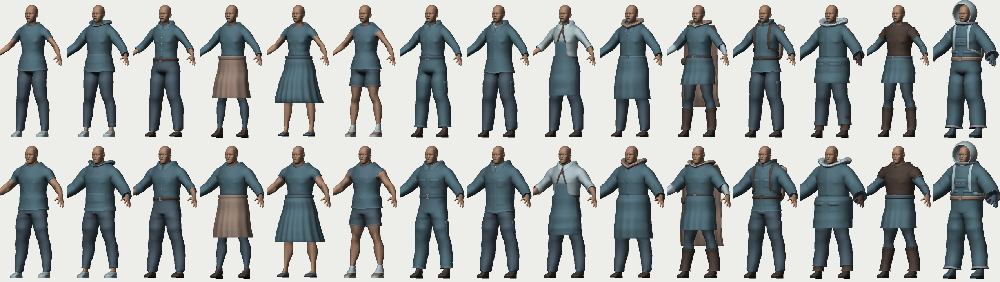
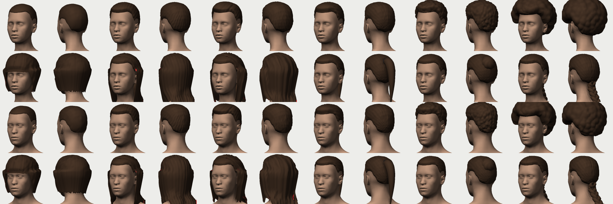
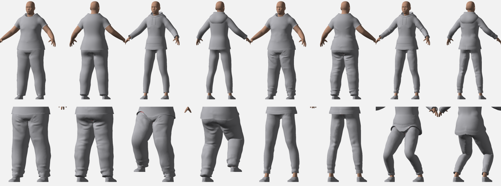
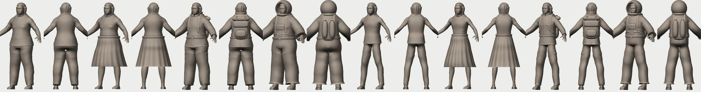
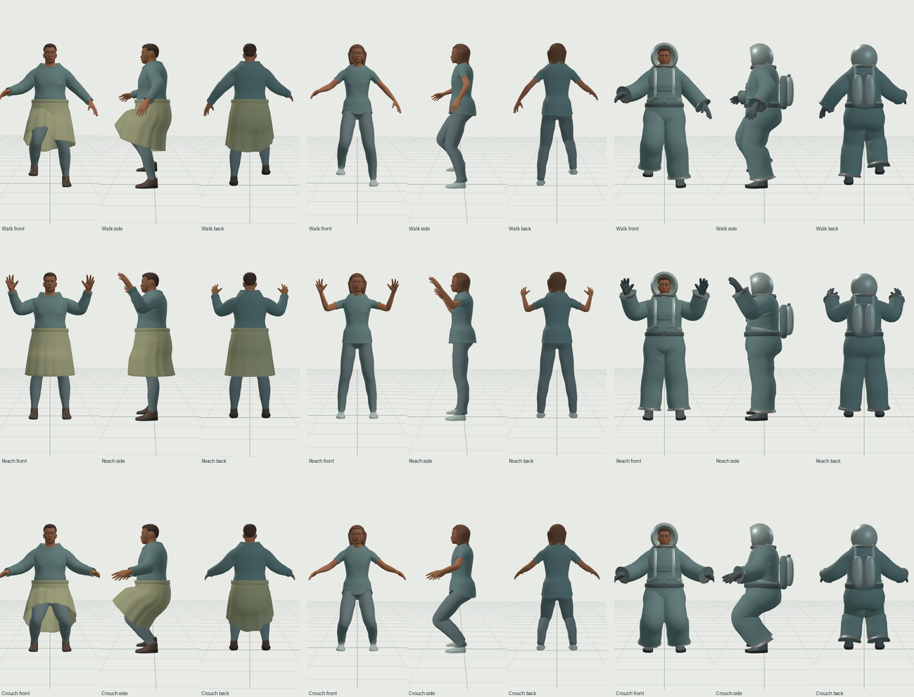

# Hair and clothing for the adult surface

`character-view/human-style.js` dresses the adult surface with hair and an outfit. Everything is generated from the body it is given, so the same style fits a slight person, a heavy one and everything between. These base garments have sculpted surfaces that remain readable in clay. The full wardrobe also includes fitted authored pieces, cloth swatches and patterned attire.





The Appearance panel also offers jewellery and waist bags. The **Dispatch folio** has a leather envelope flap and brass clasp. The **Running belt** carries a zipped pocket in the outfit?s accent colour. Both fit the waist over the clothes and follow the trunk during animation. Set `humanStyle.waistBag` to either name or `None`. A saved form without the field wears its original outfit.

## Using it

```js
import { humanStyles, defaultHumanStyle, styleHuman } from "./human-style.js";

const meshes = styleHuman(surface, { hair: "Wavy", outfit: "Explorer", hairColor: "#45352e", clothColor: "#6f7f86" }, material);
```

- `humanStyles.hair` and `humanStyles.outfit` list the names to offer. Both start with `"None"`. Names are matched without regard to case, and an unknown name adds nothing.
- `defaultHumanStyle` is no hair, no outfit and two neutral colours.
- `surface` is the result of `evaluateHuman`: positions in metres with Y up, the `game_engine` joints, and four skin weights per vertex.
- `material(color, kind)` returns the Three.js material for one mesh. `kind` is `"cloth"`, `"leather"`, `"metal"` or `"hair"`. A clay view can ignore both arguments and return one material.
- The result is an array of `THREE.Mesh` in world coordinates. Each mesh has `humanWeights` (`weights` as a `Float32Array` and `boneIndices` as a `Uint8Array`, four per vertex) and names the joint it mainly follows in `userData.styleRegion`. Meshes have positions, normals and an index, and no texture coordinates.
- The array also has a `ground` property: the lowest styled point in metres. Shoes are built with their soles on the floor the bare feet stand on, so `ground` is the floor of the body and a dressed figure needs no lift.
- Its `hidden` property is a set of source vertex ids: the skin that lies under the outfit. `humanRegions` leaves that skin out, as it does under library and tailored clothing.

Hair also takes `fringe`, one of `fringeStyles` in `character-view/human-fringe.js`: `"As cut"`, `"Parted"`, `"Swept left"`, `"Swept right"` or `"Off the face"`. Left and right are the wearer's own. A style without `fringe` is as it was cut, which is how looks saved before the option existed still read. The workshop offers it as Fringe under Appearance, an agent sets it with `setForm.set.humanStyle.fringe`, and a new random look draws a parted or swept fringe.

One cloth colour gives the whole outfit its palette: the main tone, a darker and a lighter relative, an accent, leather, soles and metal. Hair takes `hairColor`; hair ties keep their own dark tone.

A helmet hides hair that leaves the head. With the pressure suit, a ponytail keeps its combed scalp and loses the tail.

## The styles

| Kind | Names |
| --- | --- |
| Everyday | T-shirt and jeans, Hoodie and joggers, Shirt and chinos, Sweater and skirt, Day dress, Running kit |
| Work | Coveralls, Chore jacket, Workshop apron, Overcoat |
| Adventure | Traveller, Explorer, Parka, Leather armour, Pressure suit |
| Hair | Buzz cut, Crop, Side part, Swept back, Curls, Afro, Bob, Long, Wavy, Ponytail, Bun, Braid |

The outfits are ordinary, practical clothes with real ease. Necklines sit at the collarbone, hems are at or below mid-thigh, and nothing is cut to show the figure. The pressure suit is the bulky option: a loose shell with lock rings, a chest panel, an open-faced helmet and an air pack.

## How the clothes are made

A garment starts as the part of the body surface it covers. The cut runs along smooth fields on the body, such as distance along an arm or height, and triangles are clipped along the cut, so sleeves, hems and necklines end in clean edges. Every cloth vertex keeps the skin weights of the skin under it, which is why the clothes follow the same animation as the body.

The cut piece then becomes cloth in four steps:

1. The figure under it is softened so small anatomy does not print through. The front of the chest is softened most.
2. The piece is lifted off the skin by the garment's ease.
3. It is draped over a radial map of the figure. The map bridges hollows around each ring, which carries cloth straight across the breastbone and the small of the back, and it limits how fast cloth may return to the body below a bulge, so a shirt hangs from the chest instead of clinging under it.
4. A few smoothing passes relax it. They may not shrink the cloth back below most of the room the drape gave it.

Trouser legs join in a seam a little below the body, so there is no opening under the seat.

### Folds

A draped piece is smooth, and smooth cloth over a leg reads as a rubber tube. `character-view/human-style-folds.js` gives it the folds that everyday cloth has at rest.



- Each fold is one tapered ridge, drawn on a chart of the place it belongs to: around a limb by distance from its joint, across the front or the back of the hips, around the waist. The folds are the ones cloth makes there: a zigzag behind the knee and inside the elbow, crescents stacked above a cuff, lines fanning from the fork of the legs and from the armpit, one or two under the seat, a long one down the thigh, and a sag at the waist of a top.
- Every fold is placed by its own draws from a seed, and the left and right sides draw separately, so a garment is never mirrored and two garments differ.
- How deep a fold is depends on how much room the drape left at that place. Snug cloth raises a low crest. Cloth with room also sinks towards the body beside each crest, so loose cloth gathers instead of swelling, and it takes fewer, broader folds. Cloth never sinks below the least room the garment keeps. Skin-tight cloth takes none.
- The body cage has edges of about 35 mm, too coarse for a fold. The piece is cut finer only where its folds need it, down to about 12 mm, and new points lie on the curve through their neighbours.
- Skin weights change unevenly from one point to the next across a knee or an elbow. Cloth takes one even blend across the joint, no wider than the skin's, so it bends along a clean line.

`garment` takes `folds`: 1 is everyday cloth, 0 leaves the piece as draped, and `{ amount, size, detail }` sets the depth, the width of the folds and how finely they are cut. It also takes `over`, a list of shells the cloth is worn over. Snow trousers pass the boot shafts, and stay outside them with their folds.

The folds are part of the resting shape. They move with the skeleton and do not change as a joint bends.

Open edges are closed back to the skin with a short recess, so there is no visible underside. Cuffs, waistbands and hems are a second strip of cloth. Skirts, shoes, capes, aprons and the hanging part of long hair are lofted sheets. A skirt has a lining, and each point of it takes the skin weights of the leg behind it, so a lifted thigh carries the cloth. Across the middle the two legs share the cloth. Pockets, plackets, buttons, belts and straps are placed by casting rays onto the finished cloth. A chest pocket is left out where the cloth under it is not flat enough to carry one, and any panel is left out when part of it would land past the edge of a limb.

A skirt, a belt, a buckle and a pocket take the skin weights of the trunk and legs only. A hand hanging beside a coat is the nearest skin to its skirt, and cloth weighted to it would follow the hand.

A full skirt stands off the coat it hangs from. With `yoke`, its top slopes in and ends just under the coat's cloth, so nobody looks down into a gap. The parka's skirt has one, and its drawcord lies on the join.

A hood worn down is a lofted pouch. It leaves the neck opening as a low stand, lies on the shoulders, and hangs between the shoulder blades, resting on the cloth found under it by rays. `hood` in `human-style-cloth.js` builds it for the hoodie, the parka and the traveller's cloak. `roll` builds the band around a neck opening: a wound scarf or a fur trim.

### Skin under the clothes

`character-view/human-style-conceal.js` lists the skin an outfit covers. A shell covers the skin points it was cut from, except within 40 mm of one of its open edges, where a viewer can see in. The covered skin is not drawn. It cannot show through cloth when a reduced export moves both surfaces, and the triangles it used go to what is visible.

## How the hair is made

The scalp is cut from the head along a hairline, refined, and raised into a volume. Grooves run away from a comb point, partings are narrow valleys, and curls are rounded lumps. Short styles are this one piece.

Longer styles add locks that fan out from a root point on the scalp. Each lock runs over the skull along a great circle, leaves it below the widest part of the head, falls straight, and lies on the back where the body is in the way. Locks end at their own lengths, and the gaps between them deepen towards the tips. The front edge thins out towards the temples and keeps the face clear. Tails, the braid and the bun are tubes and a small lofted knot.

### The hairline

Every style measures one head frame on the adult it is built for: the cranium centre and radii, both eyes, how far the head reaches in each direction, and a hairline that runs from the forehead past the temples and behind the ears to the nape. The scalp piece is thin at the hairline and thickens with distance from it, and the line wanders a little, so hair grows out of the skin instead of ending in a wall.

### Combing a fringe

`combFringe(positions, frame, fringe)` moves the vertices of any groom that hang over the face and leaves the rest alone. Hair is followed from the hairline down. Over the face it may hang only as far as an arch that is shortest at the parting and reaches the brow beyond the eyes, so each strand is shortened in proportion, leans from the parting towards the temple and is laid close to the forehead. Past the temples the hair keeps its length. Nothing above the hairline moves, and every moved point keeps a gap over the skin.

The window that stays clear comes from the measured eyes, so it follows a wide or narrow head, close-set or wide-set eyes and a high or low forehead. The procedural Bob and the four library styles are combed. The library styles are combed on their fitted cards before the cards are trimmed to their outline, and the trimmed points over the forehead are lifted out of the skin afterwards.

Library hair also wears a thin layer of roots inside the hairline, in a darker tone of the hair colour. Gaps between cards and ragged card edges then show hair instead of scalp, in the workshop and in an exported file.

### A strand groom

`"Tapered crop"` and `"Close crop"` are grown on the head they are worn on, by `strandGroom` in `character-view/human-groom.js`. They are in the Hairstyle list beside the other styles and are set with `humanStyle.hair`. A random look draws its hair from the styles it has always drawn from, in the same order, so a seed keeps its colours, fringe and every later choice. A look whose draw lands on `"Swept crop"` wears `"Tapered crop"`. `"Swept crop"` stays a style to choose by hand, and a saved look keeps the hair it names. `"Close crop"` is chosen by hand.

The groom is two meshes that ride the head:

- Roots: a thin layer cut from the figure's own scalp along the hairline. Its vertex colours run from the skin tone at the hairline to the hair colour a few degrees in, so the cut fades into the skin, and darker and lighter streaks follow the combing.
- Strands: narrow cards laid along the combing, each seated on the scalp from root to tip. A strand rises by the length of the cut at that point and settles again towards its tip, and it lies flatter at the crown, where hair fans out in every direction. The cards carry one small alpha-tested picture of tufts that `tuftPixels` draws from numbers, so the groom needs no image file. The cards are a plain cutout without alpha to coverage, in the workshop as in an exported file. The roots cast the shadow of the hair, and the strands are left out of the shadow pass.

The hairline is drawn for each figure. The ears are found once on the reference adult as the folded skin at the side of the head, and their front, back, top and lowest point are then measured on the figure being groomed. The line runs across the forehead, down to a sideburn in front of the ear, over and behind the ear with a gap, and down to the nape. A scalp map gives the radius, normal and nearest vertex of the head in every direction about the ear axis, leaving the ears out, which is what seats roots and cards on a wide, narrow, long or short head alike. Beside an ear two surfaces lie in one direction, so a strand grows only where the map is the skin its root is on.

Length comes from the style: longest on top, shorter down the sides, and fading to nothing at the sideburn, round the ear and at the nape. The fade is narrower at the temple, which is a wedge between two hairlines. Over the forehead every strand is cut to one gently wandering line, so the edge of the fringe is strand tips. The Fringe choice combs it: `"As cut"` runs forward from the crown, `"Parted"` and the two sweeps run away from a parting or from one temple, and `"Off the face"` runs back from the forehead. Combing moves the strands and the streaks, and leaves the hairline and the roots where they grow.

For a game export, the groom builds fewer, wider cards to fit thirty percent of the hair's share of the triangle target. The exporter keeps these `fibreLOD` cards whole while the body and clothing have enough triangles. On crowded figures it can simplify fibres and feathers to preserve the shape of boots, clothing and armour.

## Checking the result

`scripts/human-style-check.mjs` draws styled figures to a contact sheet. Faces seen from behind are drawn red, which shows inverted or folded geometry at a glance.

```
node scripts/human-style-check.mjs --outfit all --bodies heavy,m2 --views 25,180 --out sheet.png
node scripts/human-style-check.mjs --hair "Bob,Long" --bodies f4,m4 --frame head --clay --out hair.png
```

`--bodies` takes the built-in figures `f1` to `f4`, `m1` to `m4`, `n1`, `heavy`, `lean` and `full`. `--frame` is `body`, `head`, `bust`, `torso`, `legs` or `feet`. `--clay` uses one neutral material and `--bare` hides the body. Without `--out` the sheet goes to `.reference-cache/human-style/check.png`.

`scripts/human-style-pose.mjs` puts a dressed figure through the same regions, wardrobe and skinning as an export, poses it with the animation clips, and prints numbers that need no renderer:

```
node scripts/human-style-pose.mjs --bodies heavy,lean --outfit "Sweater and skirt" --poses Walk:.3,Reach:.5,Crouch:.5
```

- `lowest` is the lowest point of the figure over the clip, in metres above the floor.
- `bare` counts sample points that clothing covered at rest and no longer covers in the pose.
- `pulled` counts clothing edges stretched to more than half again their resting length.

With `--out sheet.png` it also draws the poses.

Both scripts draw through `scripts/human-style-render.mjs`. It starts a headless Chrome or Edge with the platform's default renderer, draws with Three.js on the graphics card and reads the pixels back. On a machine without a browser or without a hardware renderer it draws with the CPU renderer in `scripts/human-style-raster.mjs`. Each script prints the renderer it used, and pictures differ slightly between the two.

`scripts/human-hair-check.mjs` measures a groomed head without a renderer, through `probeHair` in `character-view/human-hair-probe.js`:

```
node scripts/human-hair-check.mjs --hair "Bob,Rounded bob" --fringe all --bodies f4,m1
```

- Eyes and face: the share hidden by hair from the front and from 35 degrees to either side.
- Scalp bare: the share of the scalp inside the hairline with no hair over it, with and without the roots under library hair.
- Inside head: hair vertices more than a millimetre inside the drawn head, and the deepest one. Hair inside the neck and shoulders is counted apart.

`character-view/human-fringe.test.js` runs the same numbers for every fringe on a slim, a wide and a narrow head.

`character-view/human-style.test.js` builds every style and checks the skinning data, the joint names and the ground value. It also checks that everyday cloth has folds and tights have none, that an outfit hides the skin under it and keeps the skin at its openings, that a skirt, a pocket and a belt follow no arm, and that the top of the parka's skirt ends under the coat.

## Measured

Measured on 23 November 2026 with Node on the development PC, for a 1.66 m slim figure. Times are for one `styleHuman` call after a warm-up call, the fastest of three runs.

| Style | Meshes | Triangles | Time |
| --- | --- | --- | --- |
| Outfits, fewest triangles (Day dress) | 7 | 20,882 | 195 ms |
| T-shirt and jeans | 6 | 40,579 | 337 ms |
| Outfits, most triangles (Pressure suit) | 13 | 79,649 | 430 ms |
| Short hair (Crop) | 1 | 10,656 | 38 ms |
| Long hair (Long) | 2 | 26,560 | 58 ms |

Folds cost triangles and time. Draped only, the outfits had 14,936 to 38,032 triangles and took 141 to 225 ms.

All fifteen outfits and twelve hairstyles were drawn in colour and in clay on the heavy figure and on a tall lean one, from the front and the back.



What those sheets still show:

- Long and Wavy have a few small folded faces at the temples, where the front edge of the lengths thins out.
- On a full chest, cloth still shows a soft point at the fullest part of each side.

### Fringes

Measured on 23 November 2026 with Node on the development PC, on the built-in figures `f4` and `m1`. Eyes are the wearer's left and right; the worst of the three views is given.

| Style | Fringe | Eyes hidden | Face hidden | Scalp bare | Inside the head |
| --- | --- | --- | --- | --- | --- |
| Rounded bob | As cut | 100% of one eye from the front, both from one side | 65% to 70% | 0.0% | 43 to 45 points, up to 35 mm |
| Rounded bob | Swept left | 0% | 0% | 0.0% | 0 to 2 points, up to 1 mm |
| Crown braid | As cut | 38% to 86% of the right eye | 11% to 17% | 0.0% | 0 |
| Crown braid | Swept left | 0% | 0% | 0.0% | 0 |
| Bob | As cut | 0% | 1% | 0.2% to 0.4% | 0 |
| Bob | Swept left | 0% | 0% | 0.2% to 0.4% | 0 |
| Swept crop | As cut | 0% | 0% | 0.0%; 0.6% to 2.2% without the roots | 43 to 61 points at the ears, up to 11 mm |

The six seeded looks 8710 to 8715 were drawn before and after in colour and in clay from the front, three quarters, the side and the back with a native OpenGL renderer on the graphics card (NVIDIA GeForce RTX 5070 Ti). Before, seed 8713 hid one eye from the front and both eyes from one side; after, every eye is in view in every one of them.

What those pictures still show:

- A combed fringe is shortened, not lengthened into the sides, so a long fringe ends as a compact edge with the darker tips of its texture along it.
- The rounded bob keeps a small crease where its own parting meets a combed one.
- "Off the face" gathers the fringe into a low roll at the hairline.
- The swept crop still has a toothed edge where its cards cross the temple; the roots only fill in behind it.
- The swept crop passes through the ears, and the rounded bob through the shoulders of a broad figure, as cut and combed alike.
- Behind the ears and at the nape the scalp piece still ends in a visible step, though a lower one than before.

### Strand grooms

Measured on 23 November 2026 with Node on the development PC, on the built-in figures `f4`, `m4` and `heavy`, with the fringe as cut, swept left and off the face.

| Style | Eyes and face hidden | Scalp bare | Inside the head | Inside the neck | Triangles |
| --- | --- | --- | --- | --- | --- |
| Swept crop | 0% | 0.0% to 0.1%; 0.6% to 2.6% without the roots | 43 to 61 points, up to 11.1 mm | 96 to 107 points | 8,250 to 8,338 |
| Tapered crop | 0% | 0.0%; 20% to 26% without the roots | 0 | 0 | 9,982 to 10,252 |
| Close crop | 0% | 0.0%; 33% to 37% without the roots | 0 | 0 | 9,926 to 10,040 |

The strands of a groom leave gaps on purpose and the roots under them cover the scalp, which is why the share without roots is high.

A game model of the gallery host with the tapered crop has 2,358 strand triangles and 625 root triangles before the last merge, counted in Node through the same build step the export uses. On the six heads below, no strand point is further than 11 mm from the skin.

Of 2,000 looks drawn from seeds 8000 to 8999, 96 landed on the swept crop and now wear the tapered crop. No look differs in anything else.

The tapered crop and the swept crop were drawn side by side on six figures, among them a wide and a narrow head and dark, blond, grey and pale hair, from the front, three quarters, the side and the back, at full detail and as game models, with a native OpenGL renderer on the graphics card (NVIDIA GeForce RTX 5070 Ti). The game pictures scale the tuft picture down to the atlas tile the export is expected to give it; they are not pictures of an exported file.

What those pictures show:

- The ear is clear, the sideburn and nape end in a soft tapered line, and no strand hangs below the nape.
- As cut, the front edge is a short fringe of strand tips along a gently wandering line.
- `"Parted"` and the two sweeps change the direction of the streaks more than the outline, so they are subtle from the front.
- `"Off the face"` ends at the forehead in the even line of the roots.
- The sides read as short even stubble, with less variety than the top.
- A few short strands still stand alone at the edge of the taper in front of and behind the ear.
- In clay the strands are plain blades.

#### In the workshop and in exported files

Looked at on 24 November 2026 in Chrome on the graphics card (ANGLE, NVIDIA GeForce RTX 5070 Ti, Direct3D 11), with no page errors.

- Hairstyle under Sculpt, Appearance lists both grooms after the earlier styles. The gallery host opens with the swept crop it was saved with, takes the tapered crop from the list, and saves it.
- Fringe combs the groom in all five ways.
- Close crop and tapered crop were put on the wide head of seed 8713 and the narrow head of seed 8715, and the newly drawn looks of seeds 8672 and 8607 open wearing the tapered crop.
- The gallery host with the tapered crop exports as a game file of 24,000 triangles and 3.91 MB with one material, and as a full file of 94,160 triangles and 11.20 MB. Both were opened again in a Three.js viewer. The strand picture keeps its alpha in the atlas, the ear is clear and the sideburn and nape taper in both.
- The roots fade into the textured skin of the workshop without a visible step.
- With alpha to coverage on the strand material, the workshop view broke the hair into pale speckles that read as tight curls, most on the sides and the back, while the exported files were clean. A page with the workshop's lights and one switch changed at a time showed that alpha to coverage alone does this, and that shadows from the strands change nothing that shows. As a plain cutout the gallery host, the wide head of seed 8713 and the looks of seeds 8672 and 8607 are clean from the side and the back in the workshop.
- The close crop still shows the grain of its short strands on the sides.

### In motion

Measured on 23 November 2026 on the development PC. A heavy adult (1.70 m) and a lean one (1.84 m) were each exported from the workshop as a GLB in the pressure suit, the sweater and skirt, and the T-shirt and jeans. Each file was opened in the standalone player (`examples/play-model.js`) and photographed in Walk, Reach and Crouch from the front, the side and the back. Chrome drew on the graphics card (ANGLE, Direct3D 11, NVIDIA GeForce RTX 5070 Ti).



| Check | Result |
| --- | --- |
| Player ground check, all six files, clips Idle, Walk, Crouch and Reach | Lowest vertex 0.000 m in every clip |
| Full-detail files | 12.1 to 13.6 MB, 137,725 to 158,363 triangles, 8 to 11 materials, 4 clips |
| Game-detail pressure suit, heavy adult | 2.4 MB, 24,001 triangles, 1 material, same ground result |
| Enclosed openings at the trouser seam, rays cast through the crotch from the front, four outfits with legs on eight figures | None, except a slit one to two millimetres wide between the legs of the running shorts on the fullest figure |

Numbers from `scripts/human-style-pose.mjs` for the same figures, Walk / Reach / Crouch:

| Outfit | Figure | Bare | Pulled edges |
| --- | --- | --- | --- |
| Sweater and skirt | heavy | 0.7% / 0.1% / 1.2% | 0.69% / 0.80% / 0.71% |
| Sweater and skirt | lean | 0.3% / 0.0% / 0.3% | 0.78% / 0.43% / 0.47% |
| T-shirt and jeans | heavy | 1.5% / 0.3% / 2.9% | 0.40% / 0.47% / 1.05% |
| T-shirt and jeans | lean | 0.7% / 0.0% / 1.2% | 0.04% / 0.32% / 0.17% |
| Pressure suit | heavy | 2.3% / 2.0% / 2.5% | 0.51% / 0.64% / 1.18% |
| Pressure suit | lean | 0.6% / 0.6% / 0.8% | 0.17% / 0.39% / 0.41% |

Bare is a share of the sampled points that something covered at rest. Skin under an outfit is no longer part of the figure, so there are about half as many such points as when the skin was still there, and the same count is a larger share. On the heavy figure in a T-shirt and jeans, 24 of 1,274 points were skin coming through in Crouch with the skin left in, and 7 of 683 are with it left out. The pressure suit's count is nearly all sleeve points that face the belt or the air tanks at rest and face away from them once the arm moves; none of them is skin. Pulled edges count more where cloth is cut finer, and it is cut finer at the knees and armpits, where cloth stretches most.

Both style-check scripts also ran on the hardware WebGL renderer. The heavy adult in a T-shirt and jeans was checked from the front and back. The sweater and skirt were checked at three angles in Walk and Crouch. In the full-detail standalone player, both the lean and heavy jeans exports carried one skeleton and four playable clips. At the tested phases their lowest posed vertices reached the floor within 1 mm. A slight crease remains visible where the heavy figure's trouser legs join in Reach.

What the player pictures show:

- The first skirt render had both thighs coming through the front of the skirt in Walk and Crouch. After the skirt took its weights from the leg behind it, the same renders are clean on both figures.
- The belt and air pack of the pressure suit took a skin-like accent colour, which read as a bare waist. The accent now avoids skin hues, in full and in game detail.
- Seen from behind, the fold of a bent knee is a hard line on trousers and suit legs.
- The hem of a T-shirt lifts as a stiff edge when a thigh rises under it.
- The hem of a skirt follows the knees, so it rises unevenly in Walk and Crouch.
- The helmet is an open shell without a visor.
- Long hair and skirts follow the skeleton only, so they do not swing.

Not yet looked at in motion: the other twelve outfits, and long hair on a turning head.

### Folds, layers and game detail

Measured on 23 November 2026 on the development PC. Figures were built, skinned and posed in Node as an export does, and drawn offscreen on the graphics card (NVIDIA GeForce RTX 5070 Ti) with `scripts/human-benchmark/hb_raster.py` at 300 pixels per metre.

Five figures (heavy, lean, `f3`, `m2` and one with a flat seat) wore six outfits (T-shirt and jeans, Hoodie and joggers, Shirt and chinos, Coveralls, Chore jacket, Parka) at rest and in Walk, Crouch and Reach: 120 cases, each seen from twelve directions. The table compares draped cloth with folded cloth, summed over the cases and their views.

| Check | Draped only | With folds |
| --- | --- | --- |
| Skin in view, the five outfits without a hood trim (100 cases) | 3,431,531 px | 3,433,117 px |
| Skin in view, Parka (20 cases) | 44,621 px | 50,382 px |
| Cloth seen from its inside, the five outfits (100 cases) | 20,137 px | 21,828 px |
| Cloth seen from its inside, Parka (20 cases) | 15,549 px | 9,274 px |
| Cloth triangles in one outfit, average | 20,489 | 57,486 |

The parka shows more skin because its fur trim is slimmer and lies lower, so more of the neck is in view.

Two saved looks, a traveller and a heavy adult in the parka, were also built at game detail (24,000 triangles) and compared with full detail from 36 directions. Before is draped cloth over the whole skin. After is folded cloth with the skin under it left out.

| Check, summed over 36 views | Before | After |
| --- | --- | --- |
| Traveller, skin in view at game detail that full detail covers, idle / crouch | 9,590 / 18,079 px | 99 / 25 px |
| Parka, the same | 2,073 / 2,374 px | 1,117 / 1,207 px |
| Traveller tunic skirt seen from its inside at game detail, idle / crouch | 2,073 / 19,383 px | 607 / 2,122 px |
| Parka skirt seen from its inside at game detail, idle / crouch | 47,836 / 73,639 px | 0 / 1,473 px |
| Triangles before reduction, traveller / parka | 171,732 / 171,681 | 161,416 / 172,911 |

What those pictures show:

- Trousers and sleeves read as cloth at rest and in motion: folds behind the knee and at the cuff, tension lines at the hips, and no two legs alike.
- Coat skirts, pockets and belts followed a hand in Walk and Reach and were drawn out into long shards. They now stay on the hips.
- Snow trousers passed through the boot shafts under them. They now lie over the boots, with a visible step at the boot top.
- Seen from behind, a bent knee is still a shelf: the thigh's cloth stands over the calf's. The line is clean and the calf no longer comes through, but the folds do not deepen as the knee bends.
- The hem of a T-shirt or a jacket still lifts as a stiff edge when a thigh rises under it, and its underside shows.
- A small sliver at the top of the seat cleft faces inward on full figures, with and without folds.
- Jeans on a heavy figure stack at the ankle strongly enough to read as a gathered cuff.
- A fur trim is still an even ring around the hood's opening.
- At game detail a boot's sole is reduced to about twenty triangles and mostly disappears into the boot, an undershirt shows through a tunic in a few specks, and the wrist shows at the edge of a glove. These come from reducing each layer on its own, not from the cloth's shape.

## Origin and licence

The procedural garment and groom builders are released under the project MIT licence. Their input is the adult surface, whose origin is recorded in [licenses/makehuman-cc0.md](licenses/makehuman-cc0.md).

## Fitted hair and sewn clothing

Blunt bob, Low ponytail, Long centre part and Side-swept pixie are fitted to the edited head. New looks can draw them as variants of the corresponding haircut. Overshirt and denim, Striped shirt and jeans, and Track top and leggings retain the source cloth shading and accept independent dyes on their upper and lower pieces. Each uses the same joint rig as other adult clothing. Pearl studs, Hammered hoops, Enamel drops and Single ear pendant fit the edited earlobes.

The fitted assets and their garment normal and occlusion maps come from the September 2020 CC0 release by Data Collection AB, Joel Palmius and Jonas Hauquier. The compiled library uses the native body bindings from the source meshes and the coordinates of the sewn UV panels. The raw archive is local. [MakeHuman system asset pack](https://static.makehumancommunity.org/assets/assetpacks/makehuman_system_assets.html)

### Folds in game exports

A folded sleeve or trouser leg carries the height of the folds onto its cloth panels. The game export bakes the slopes into the garment normal map, so a knee or cuff can catch light along its folds after mesh reduction. Left and right panels keep their own coordinates and skin weights. At a distance the outline still depends on the triangles retained in the game mesh.

The evening gown has a gathered overskirt with a curved hem. The brocade follows the sewn panel around that hem, using an original scallop embroidery drawing. The sash and lining keep their own dyes. A folded shirt collar tucks into a closed standing jacket collar and stays visible when the jacket opens.
